<h1 align="center">EterX-Agent</h1>

<p align="center">
  <strong>An AI agent workspace for coding, research, documents, and work on your computer.</strong>
</p>

<p align="center">
  
  
</p>

<p align="center">
  <a href="https://youtu.be/fR42EhxrjII?si=Gw0fPMfN4gYRlfSb">
    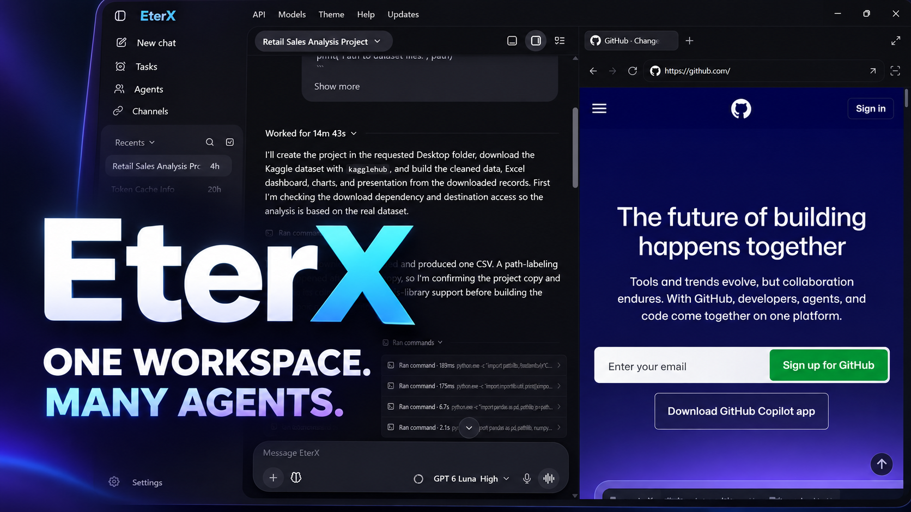
  </a>
</p>

EterX brings conversations, tools, files, terminals, browsers, and collaborating agents into one desktop application. Choose a model and an agent, describe the outcome you want, and follow the work as it happens. You can steer an active task, inspect each delegated agent in its own tab, review file changes, or enable a proxy agent to supervise longer workflows.

The application runs on **Windows, macOS, and Linux**. Chats, settings, and memory are stored locally; model inference runs through the cloud provider or local model server you connect.

<p align="center">
  <a href="https://youtu.be/fR42EhxrjII?si=Gw0fPMfN4gYRlfSb">Watch demo</a> ·
  <a href="#install-eterx">Install</a> ·
  <a href="#first-run">First run</a> ·
  <a href="#choose-your-agent">Agents</a> ·
  <a href="#agent-tabs-and-collaboration">Agent tabs</a> ·
  <a href="#models-and-external-services">Models</a> ·
  <a href="#development">Development</a> ·
  <a href="#documentation">Documentation</a>
</p>

## What you can do

- **Choose how to work.** Switch between Chat, General, Coding Lite, Coding Heavy, and your own custom agents.
- **Follow multiple agents.** Open separate sub-agent tabs, inspect their activity, send guidance, and control their execution.
- **Work alongside your files.** Use a workspace with file browsing, editing, change review, an integrated terminal, a browser, and side chats.
- **Delegate longer goals.** Enable Autonomous mode and communicate with a proxy agent that supervises the main worker.
- **Repeat useful workflows.** Schedule tasks, review run history, and enable background operation in the desktop app.
- **Connect your tools.** Configure cloud or local models, web search, image and video services, messaging channels, connectors, MCP servers, and skills.
- **Keep context across long tasks.** Use local memory, context compaction, per-chat limits, and token usage reporting.

### Light and dark themes

Choose a light, dark, or system theme in **Settings → Appearance**.

<p align="center">
  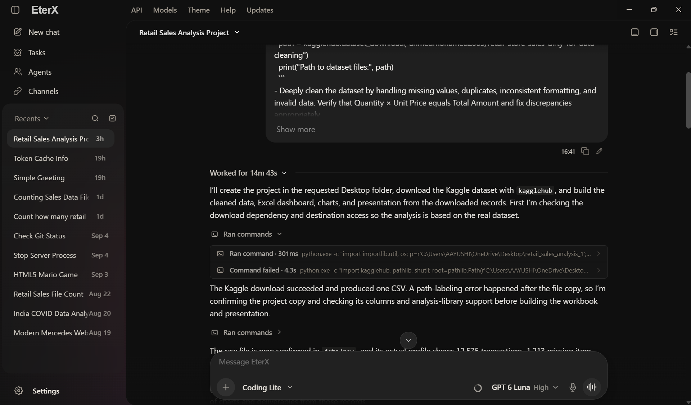
  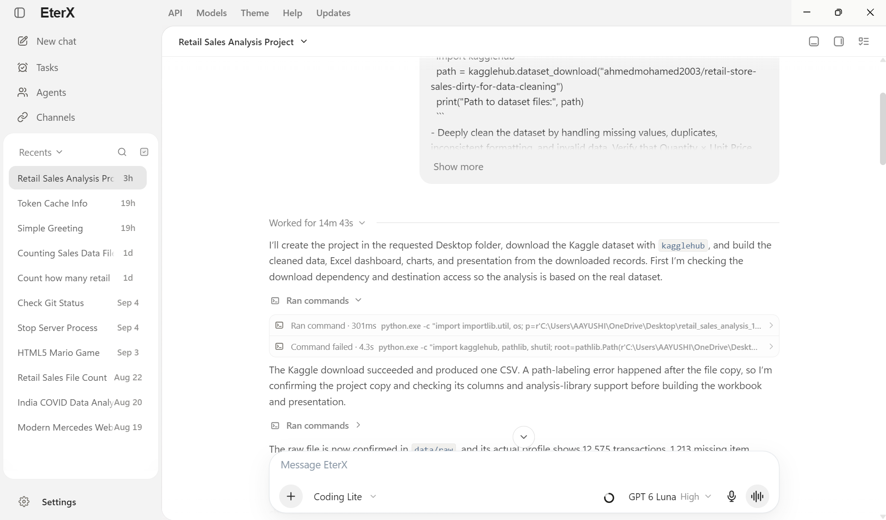
</p>

## Install EterX

Use the command for your operating system. The bootstrap detects your processor, downloads the matching published release, checks its SHA-256 manifest, and installs the compiled desktop application. **Desktop users do not need Node.js, npm, or the source repository.**

Downloads use bounded retries and a persistent partial-download cache. If a connection stalls or the terminal closes, rerun the same command to resume the matching release.

### Windows

Open **PowerShell**, paste this command, and press Enter:

```powershell
irm https://raw.githubusercontent.com/harshilsoni5666/EterX-Agent/main/install.ps1 | iex
```

Run it directly in PowerShell without wrapping it in another `powershell.exe` invocation. Keep only one installer running at a time.

The per-user NSIS installer lets you choose the application folder and Desktop/Start Menu shortcuts. The default per-user installation does not require administrator access. Launch EterX from the shortcut when installation finishes.

### macOS

Open **Terminal**, paste this command, and press Return:

```bash
curl --fail --silent --show-error --location --retry 5 --retry-delay 3 --connect-timeout 60 --max-time 300 https://raw.githubusercontent.com/harshilsoni5666/EterX-Agent/main/install.sh | sh
```

The same command supports **Apple Silicon and Intel**. The default location is `~/Applications/EterX.app`.

The installer replaces the application using an atomic bundle swap. If macOS quarantines an unsigned build, it explains the approval step and supports Apple's **Open Anyway** flow. If replacement or runtime startup fails, the existing installation is restored.

Installation diagnostics are written to `~/Library/Logs/EterX/install.log`; desktop runtime diagnostics are written to `~/Library/Application Support/EterX/eterx-desktop.log`.

### Linux

Open a terminal and run:

```bash
curl --fail --silent --show-error --location --retry 5 --retry-delay 3 --connect-timeout 60 --max-time 300 https://raw.githubusercontent.com/harshilsoni5666/EterX-Agent/main/install.sh | sh
```

The installer selects the **x64 or ARM64 AppImage**, installs it under the per-user XDG data directory, and creates an application-menu entry and `~/.local/bin/eterx` launcher. It uses FUSE when available and falls back to AppImage extract-and-run mode when needed.

> [!NOTE]
> These commands require a published native release. Package formats, release checks, signing, and recovery are documented in [Release operations](./docs/releasing.md). Unsigned builds may show operating-system publisher warnings; a failed SHA-256 verification must be resolved before installation.

### Updates

EterX checks for updates when the desktop window opens or becomes visible, and periodically while it remains visible. **Downloads and installation require your action.** Open **Settings → Updates** to check manually, review an available release, download it, and choose **Restart and install**.

Windows uses the NSIS updater; Linux updates the matching AppImage. Signed macOS builds use the native updater, while unsigned builds use a verified bundle replacement with rollback. Application updates preserve the separate user-data directory described in [Local data and privacy](#local-data-and-privacy).

## First run

1. Open **Settings → API** and add a key for the model provider you want to use. For a local model server, configure its endpoint in **Settings → Models**.
2. In **Settings → Models**, load the provider's catalog and add a specific model to your saved model list.
3. Return to the chat input and select that model. EterX requires an explicit model selection.
4. Open the **agent selector** and choose Chat, General, Coding Lite, Coding Heavy, or a ready custom agent.
5. Select a project folder or attach the files relevant to your task. Describe the outcome, scope, and deliverable you want.
6. Follow the activity feed, review changes and outputs, and send guidance while the agent works.

For example: “Review this project and update its README to match the implemented features. Preserve the screenshots and edit only the README.”

Web search and image/video generation have their own setup under **Settings → External service**. Live voice has separate credentials under **Settings → Live Convo**.

## Choose your agent

The agent selector in the chat input controls the worker for your conversation. The model selector controls the provider and model used by that worker.

| Agent | Best suited to | Default tool access |
| --- | --- | --- |
| **Chat** | Questions, explanations, and direct conversation | Optional web search |
| **General** | Research, writing, documents, file work, and tasks across applications | Shared agent tool library |
| **Coding Lite** | Focused code changes and local project work | Terminal execution and file editing |
| **Coding Heavy** | Coding that also needs browser inspection, research, or longer task coordination | Coding Lite tools plus browser, search, questions, planning, checkpoints, context recall, waiting, and skill guidance |
| **Custom agents** | Reusable specialist roles and workflows | Tools and instructions configured through Agent Builder |

Open **Settings → Agents** to inspect, enable, disable, or reset tools for each built-in agent. The table describes the defaults; your settings determine the tools exposed to a run. Chat remains limited to conversation and optional search.

Agent and model choices are saved with the conversation. Changing the selected agent during an active run applies to a subsequent turn; the current run keeps its worker identity.

<p align="center">
  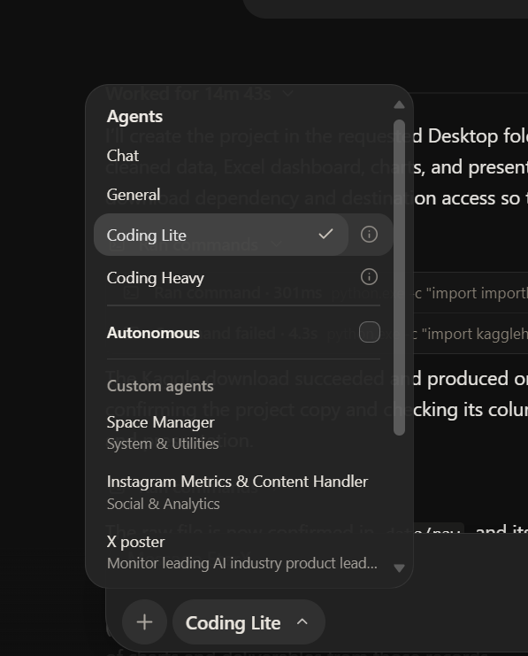
</p>

**Autonomous mode** is a separate supervision setting for tool-using agents. It adds a proxy supervisor to the selected workflow. See [Autonomous mode](#autonomous-mode).

### Composer controls

Type `/` in the chat input to access **Plan mode**, **Compact**, **Chat usage**, and **Workspace**. Plan mode requests a visible task plan before execution; use it with an agent whose planning tools are enabled. The other controls let you compact the current conversation, inspect usage, or change its workspace without leaving the chat.

You can send guidance while a task is running. EterX routes active-run steering and queued follow-ups according to the conversation's worker and run state. Set response preferences and reusable instructions under **Settings → Personalization**.

## Agent tabs and collaboration

When a worker delegates part of a task, its sub-agents appear in the **agent workspace tabs**. Use the dock to switch between the main conversation and each delegated worker.

- **Inspect the right worker.** Each tab shows that agent's conversation, activity, and execution state.
- **Guide individual agents.** Send a follow-up or change the task in the selected worker's tab.
- **Keep controls scoped.** The composer reflects the active worker. A sub-agent tab keeps its agent identity; model changes apply at the next run boundary.
- **Manage execution.** Pause, resume, or stop workers, and use the overall stop controls when necessary.
- **Organize the dock.** Drag sub-agent tabs to reorder them and use the overflow menu when more workers are present.
- **Revisit completed work.** Retained activity lets you inspect earlier sub-agent work within the chat.

Delegation can split research, implementation, review, or verification into independent assignments. Agents coordinate through a mailbox that supports questions, discoveries, handoffs, and interrupt, deferred, or silent delivery. The available delegation tools and agent configuration determine whether a run can create sub-agents.

## Workspaces, files, and execution

Select a folder to give the agent a project location for relative file paths and commands. Chats without a selected folder use a durable EterX working directory. Multiple chats can work in the same folder while keeping their conversation histories and activity separate.

The side workspace brings related tools into the conversation:

| Panel | What it provides |
| --- | --- |
| **Files** | Project tree, file opening and editing, image previews, and supported document previews |
| **Review** | File changes made in the chat, with expandable diffs |
| **Terminal** | Local shell sessions, live output, and a choice of side or bottom placement |
| **Browser** | Website viewing, local previews, and screenshot capture |
| **Side chat** | A second conversation alongside the current task |

<p align="center">
  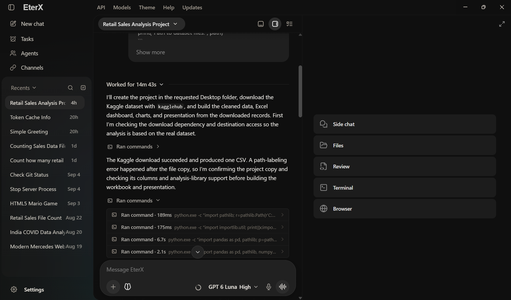
  <br /><br />
  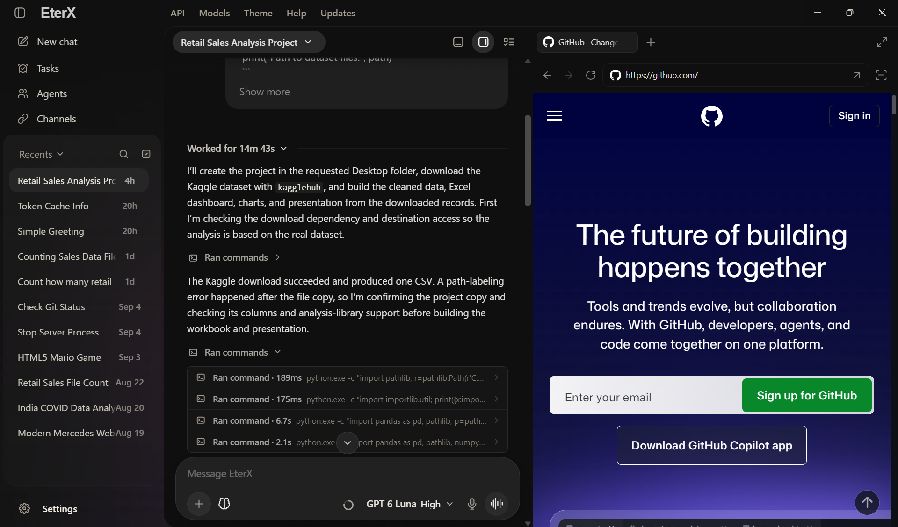
</p>

The terminal runtime supports commands, independent command batches, and managed background processes. Running processes keep their task identity and output cursor across turns, so an agent can inspect ongoing work without launching it again. Terminal details retain the working directory, actual invocation, output, and available exit status.

Choose the integrated shell and open destination in **Settings → General**. Environment settings support local execution configuration; existing project environments can be used without automatically creating a new environment when a chat opens.

See [Workspace runtime](./docs/workspace-runtime-contract.md) for folder resolution, environment behavior, and process continuity.

## Autonomous mode

Autonomous mode adds a **proxy agent** that works with the main worker on your behalf. It can monitor progress, provide guidance, and help address drift, errors, or stalled work.

<p align="center">
  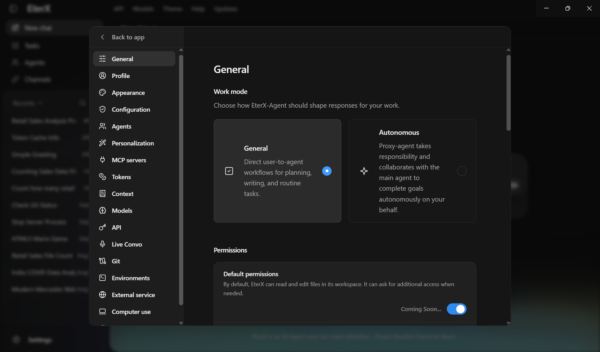
</p>

Enable Autonomous mode in **Settings → General**. The proxy panel lets you:

- Select the proxy model and choose **High**, **Normal**, or **Minimal** intervention.
- Communicate directly with the supervisor about goals, preferences, and approval boundaries.
- Pause, resume, or disable supervision for the current workflow.
- Follow the supervisor's messages alongside the main agent's work.

Define the outcome and boundaries clearly. Supervision uses an additional model runtime and contributes to provider usage.

## Scheduled tasks and background work

Open **Tasks** to create a task with instructions, a model and agent, a run time, recurrence, and priority. Tasks can create a new chat or continue an existing conversation. The task view includes **My List**, **Queue**, and **Completed**, with recorded run history and links back to the work.

<p align="center">
  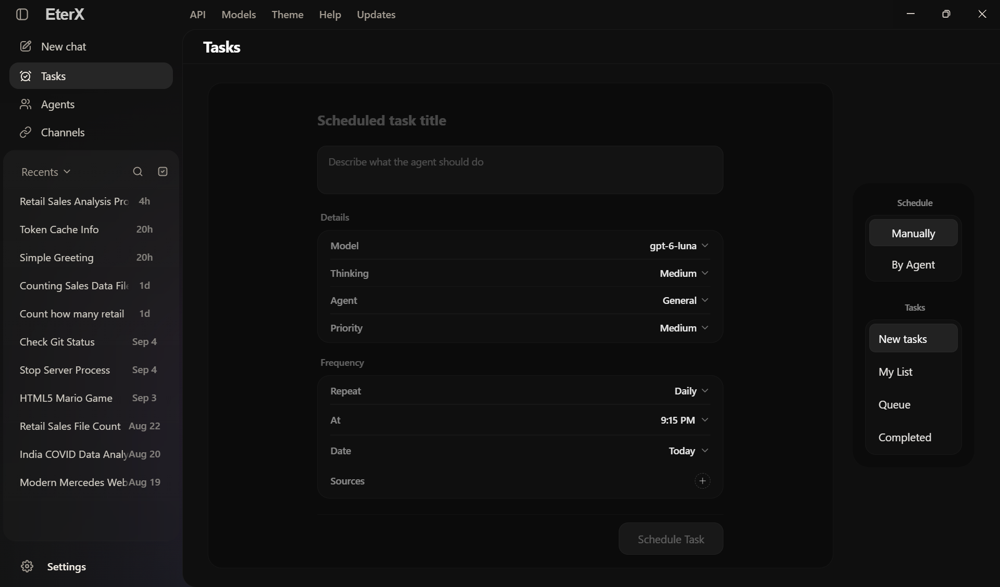
</p>

You can also ask an agent with the scheduling tool enabled to create or manage tasks.

Desktop background settings in **Settings → General** control:

- **Continue active chats in background** — keep supported chat runs working when the window is hidden or closed to the tray.
- **Run scheduled chats in background** — dispatch due tasks and record their runs while the window is hidden.
- **Start background companion at sign-in** — start enabled background workflows when you sign in.

Background operation requires EterX to remain running and the computer to be awake. **Quit EterX** from the system tray fully shuts down the app.

## Agent Builder

Create a custom agent from **Agents**, then describe its role and workflow to the Builder. You can specify its mission, response style, instructions, preferred model, tool access, and channel or connector requirements.

The Builder creates and refines the agent's profile, selects tools, and checks readiness before it becomes available for use. It can configure reusable capabilities such as prompt macros, tool chains, and agent-scoped code. Dedicated builder controls are isolated from normal agent runs.

The **Agents** view supports selecting ready agents, returning to the Builder to edit them, and importing or exporting agent and flow packages. Ready custom agents also appear in the chat's agent selector.

## Models and external services

EterX connects to multiple model providers through native and OpenAI-compatible adapters. **Model IDs come from provider discovery and explicit selection**, rather than a shipped default. The runtime retains the selected provider/model pair; rotating credentials does not silently select another model.

### Model connections

| Connection type | Providers and runtimes |
| --- | --- |
| Native and dedicated adapters | Google Gemini, OpenAI, Anthropic, Perplexity |
| Cloud APIs and gateways | OpenRouter, Mistral, Groq, DeepSeek, xAI, Cerebras, Together AI, Fireworks AI, SambaNova, DeepInfra, Hugging Face, NVIDIA NIM, Cloudflare Workers AI |
| Additional compatible services | Novita AI, Qwen Cloud, Xiaomi MiMo, Tencent TokenHub, Z.AI / GLM, Kimi / Moonshot, StepFun, MiniMax, Ollama Cloud, Arcee AI, GMI Cloud, Kilo Gateway, OpenCode Zen, Upstage Solar |
| Local model servers | Ollama, LM Studio, vLLM, llama.cpp |
| Custom endpoints | A configured OpenAI-compatible base URL with discoverable, concrete model IDs |

Available models and features depend on your account, endpoint, catalog, and model capabilities. **Agent workflows require tool calling.** Reasoning controls appear when supported, and attachment support depends on the provider's verified transport for that file type.

Configure provider keys, key pools, and model-specific connections in Settings. See [Universal provider runtime](./docs/universal-provider-runtime.md) for catalog discovery, request adapters, reasoning, attachments, streaming, and current limitations.

### Search, images, and video

Open **Settings → External service** to configure these separately from the chat model:

- **Web search and research:** select a search route, credentials or a self-hosted endpoint, enabled capabilities, and fallback providers. Supported routes include Tavily, Brave, Exa, Firecrawl, Parallel, SearXNG, DuckDuckGo, and xAI. Native model search can run first when supported.
- **Image generation:** select a generation provider and model, then save generated raster images into the workspace. Image generation currently accepts text prompts; reference-image editing is not implemented by the generation adapter.
- **Video generation:** configure a supported video provider and model, then create and save video outputs.
- **Image asset search:** find existing visual assets when a task calls for sourced images.

Provider availability, credentials, supported actions, and fallback behavior are detailed in [External service routing](./docs/external-services.md).

## Voice and Live Convo

EterX supports **local voice dictation** in the desktop chat input through `whisper.cpp`, and **Live Convo** for interactive provider-backed voice sessions.

Configure Live Convo's provider, dedicated credentials, model, and voice in **Settings → Live Convo**. The current provider adapters include Google Gemini Live, OpenAI Realtime, xAI Grok Voice, Deepgram Voice Agent, and ElevenLabs Conversational Agent. ElevenLabs also requires a configured agent ID.

Live tools can inspect app context and perform supported app actions. Camera and screen sharing are available through the Gemini Live transport when enabled; the other listed transports are audio-only in EterX. Microphone, camera, and screen access depend on the permissions you grant.

## Channels, connectors, MCP, and skills

**Channels** brings messaging connections and service setup into the desktop app. The gateway runs in Electron's main process, so enabled channels can continue receiving messages while the window is hidden.

- **Messaging gateway:** configured adapters support Telegram, Discord, WhatsApp Cloud, Messenger, email, a compatible Signal bridge, and custom webhooks. Setup requirements differ by platform.
- **Connect as bot:** create Telegram bot teammates with their own model and agent selections, pair an owner through a private link, and manage connection status from the bot roster. Bot conversations can use the same agent engine, tools, and workspace as desktop chats.
- **Connectors:** configure REST or MCP services for authorized data retrieval and actions. Catalog entries distinguish native adapters, MCP integrations, and setup pathways; a catalog listing alone does not mean a connection is active.
- **MCP bridge:** expose the local gateway to an MCP client using the authenticated endpoint and copyable client configuration from the gateway's advanced settings.
- **Skills:** import or edit reusable Markdown guidance. The bundled skill library covers documents, PDFs, spreadsheets, presentations, images, visualizations, templates, skill creation, and connector setup.

<p align="center">
  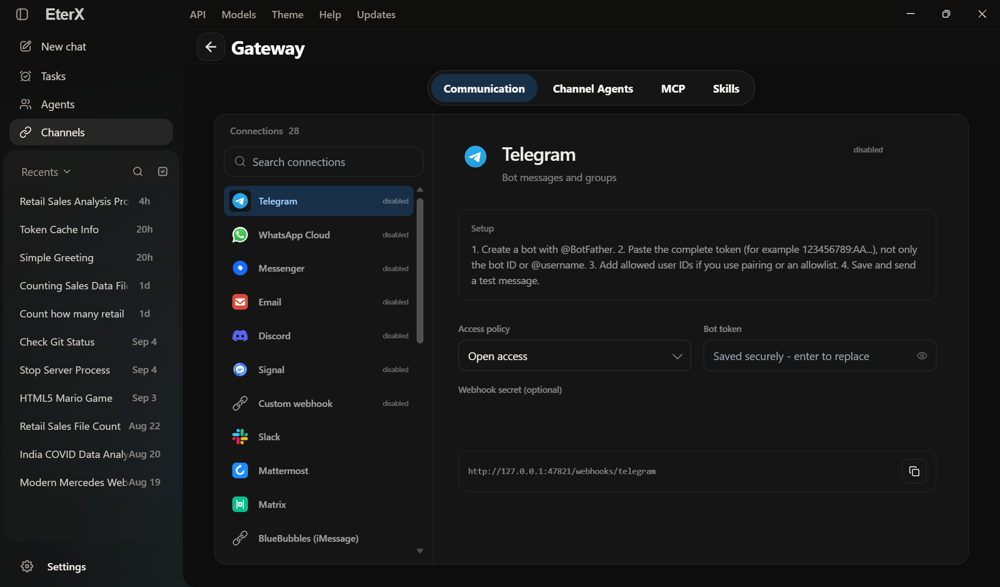
</p>

Skills guide workflows; the active agent's tool configuration controls execution access. Document and spreadsheet tasks use the available terminal runtime and libraries rather than a separate native generator tool for every file format.

See [Gateway operation](./docs/gateway-daemon.md), [Telegram bot teammates](./docs/telegram-bots.md), and the [local skill library](./src/lib/agent/skills-new/README.md).

<p align="center">
  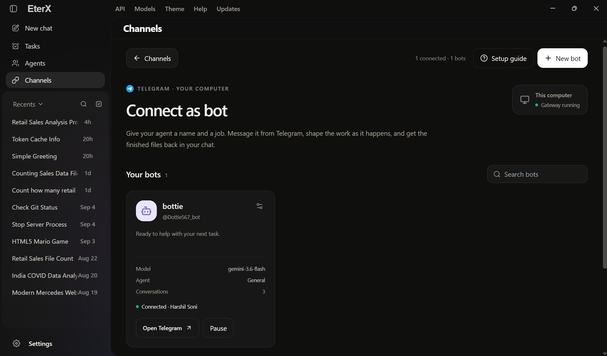
  <br /><br />
  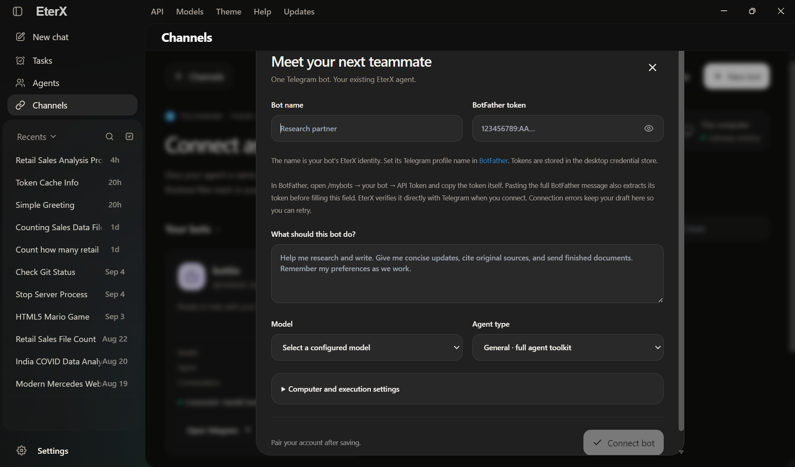
</p>

## Memory and context continuity

EterX combines conversation history, working memory, user preferences, lifetime memory, and the **EterX-Synapse** graph to retain useful context across longer tasks.

- **Local memory:** stores facts, preferences, decisions, and evidence in the EterX data directory.
- **Context compaction:** condenses older conversation and tool output when context limits are reached. Choose the compaction model, global limits, and per-chat overrides; manual compaction is also available from the composer.
- **Synapse continuity:** tracks topic changes and links source, version, state, and confidence records for relevant evidence.
- **Context Resonance:** ranks recalled evidence using relevance, confidence, freshness, validation, and a context budget.
- **Usage visibility:** inspect tokens, reported cache usage, and current context from the chat input and Settings.

Main workers, sub-agents, and proxy agents maintain their own runtime context. Memory retrieval helps provide relevant information to the selected model; it does not retrain that model.

See [Memory continuity](./docs/memory-continuity.md) and [Context Resonance](./docs/context-resonance.md) for the memory architecture and retrieval design. The broader runtime is described in the [project research draft](./docs/EterX-Agent-Research-Paper.md) by **Harshil Soni**.

## Tools and computer access

The active tool set depends on the agent, your settings, the operating system, and configured services. The current shared registry focuses on these capabilities:

| Capability | Representative tools |
| --- | --- |
| Files and execution | `workspace_edit_file`, `workspace_run_command` |
| Browser and desktop interaction | `browser_control`, `computer`, `screen_agent` |
| Web research and visual assets | `web_search`, `image_asset_search`, `image_generator`, `video_generator` |
| Planning and coordination | `task_decomposer`, `task_checkpoint`, `spawn_sub_agent`, `agent_communicate` |
| Context and workflow support | `context_memory`, `get_skill_guidelines`, `ask_user`, `wait_timer` |
| Scheduling and connected services | `scheduled_tasks`, `channel_agent`, `gateway_bridge`, `connector_mcp` |

**Windows** provides the managed EterX Computer backend. **macOS** uses native desktop providers and requires Accessibility and Screen Recording permissions for relevant actions; `cliclick` adds pointer and drag support. **Linux** desktop input uses `xdotool` with X11/XWayland, and screen capture needs a supported screenshot utility. Wayland-only input needs a compatible bridge; browser interaction remains available through the browser tool.

Optional notifications, screenshots, and OCR depend on installed OS utilities. Missing providers or permissions produce availability errors. Configure computer access under **Settings → Computer use** and per-agent tools under **Settings → Agents**.

## Local data and privacy

Installed application resources and writable user data are stored separately.

| Platform | Application location | Persistent user data |
| --- | --- | --- |
| Windows | Folder selected in the native installer | `%LOCALAPPDATA%\EterX\data` |
| macOS | `~/Applications/EterX.app` by default | `~/Library/Application Support/EterX/data` |
| Linux | `${XDG_DATA_HOME:-~/.local/share}/EterX/app` | `${XDG_DATA_HOME:-~/.local/share}/EterX/data` |

Chats, scheduled tasks, memory, settings, and default workspaces live in the profile. Browser sessions and disposable caches use separate profile directories; selected project folders stay in their chosen locations. Desktop credentials use encrypted local storage. Application updates replace the compiled bundle and preserve user data.

**Local storage does not imply local inference.** Cloud models and connected services receive the content needed for the requests you send them, including selected context or attachments. Local model servers offer a local inference route; enabled external tools can still make network requests.

Read [Desktop storage](./docs/desktop-storage.md) for profile layout and migration behavior, and [SECURITY.md](./SECURITY.md) for security reporting and project security status.

## Development

For contributors working from a source copy, the project uses **Node.js 20+** and **npm 10+**.

From the repository directory, install the locked dependencies:

```bash
npm ci
```

Start the full desktop development app:

```bash
npm run desktop
```

The desktop launcher starts the development server, chooses an available local port, and uses a separate development profile. This is the appropriate route for Electron integrations such as native terminals, the gateway, desktop browser panels, and local dictation.

For the web interface alone:

```bash
npm run dev
```

Open the address printed by Next.js, normally `http://localhost:3000`. Features that depend on Electron require the desktop application.

### Checks and packaging

| Command | Purpose |
| --- | --- |
| `npm test` | Integration checks, reference evaluations, and TypeScript validation |
| `npm run lint` | Next.js linting |
| `npm run build` | Production application build |
| `npm run desktop:build` | Prepare and package the desktop app for the current platform |
| `npm run desktop:build:win` | Windows x64 and ARM64 packaging |
| `npm run desktop:build:mac` | macOS Intel and Apple Silicon packaging |
| `npm run desktop:build:linux` | Linux x64 and ARM64 packaging |
| `npm run benchmark:context-resonance` | Synthetic context retrieval benchmark |

Native packaging depends on the target platform's build requirements. Use the release workflow described in [Release operations](./docs/releasing.md) for published cross-platform packages.

### Source CLI

The repository also includes `eterx.js`. Invoke it directly without installing a global command:

```bash
node eterx.js help
node eterx.js start
node eterx.js desktop
node eterx.js doctor
node eterx.js providers
```

The source CLI also contains setup, key configuration, diagnostics, backup, and restore commands. Installed desktop users launch the app from their operating system and manage updates through Settings. Telegram bot setup is available through **Channels → Connect as bot**.

### Project structure

```text
EterX-Agent/
├── src/
│   ├── app/                  # Next.js interface and API routes
│   ├── components/           # Chat, agents, tasks, channels, settings, workspace UI
│   ├── contexts/             # Shared React context
│   └── lib/
│       ├── agent/            # Agent runtime, providers, autonomy, memory, tools
│       │   ├── autonomy/     # Proxy supervision and controls
│       │   ├── browser/      # Browser automation
│       │   ├── computer/     # Desktop interaction providers
│       │   ├── gateways/     # Messaging daemon, adapters, bot transport
│       │   ├── memory/       # Synapse, context retrieval, continuity
│       │   ├── skills-new/   # Bundled Markdown skill library
│       │   └── tools/        # Shared tools and runtime access policy
│       ├── code/             # Coding profiles and workspace support
│       ├── live/             # Realtime voice transports and catalogs
│       └── sandbox/          # Command execution support
├── electron/                 # Native desktop lifecycle and integrations
├── public/                   # Application assets
├── docs/                     # Architecture, runtime, storage, release guides, and README screenshots
├── scripts/                  # Development, packaging, evaluation utilities
├── setup/                    # Source setup and platform packaging support
├── tests/                    # Integration checks
├── install.ps1               # Windows release bootstrap
├── install.sh                # macOS/Linux release bootstrap
└── eterx.js                  # Source CLI
```

## Documentation

| Guide | Focus |
| --- | --- |
| [Universal provider runtime](./docs/universal-provider-runtime.md) | Model discovery, capability handling, attachments, and streaming |
| [External service routing](./docs/external-services.md) | Search, image/video providers, credentials, and fallbacks |
| [Workspace runtime](./docs/workspace-runtime-contract.md) | Folders, environments, terminal execution, and process state |
| [Conversation intent and steering](./docs/conversation-intent-and-steering.md) | Follow-ups, task continuity, and active-run guidance |
| [Memory continuity](./docs/memory-continuity.md) | Persisted history and context recovery |
| [Context Resonance](./docs/context-resonance.md) | Evidence selection, scoring, and benchmark methodology |
| [Adaptive cognitive harness](./docs/adaptive-cognitive-harness.md) | Runtime coordination and execution behavior |
| [Gateway operation](./docs/gateway-daemon.md) | Background channels, adapters, authorization, and MCP |
| [Telegram bot teammates](./docs/telegram-bots.md) | Bot setup, pairing, conversations, and routines |
| [Desktop storage](./docs/desktop-storage.md) | Installed profiles, writable data, and migration |
| [Release operations](./docs/releasing.md) | Native packaging, signing, publishing, and recovery |

## Project status and license

EterX-Agent is under active development. Feature availability depends on the installed release, selected model, connected services, and host-platform permissions.

Built by **Harshil Soni**. Licensed under [Apache License 2.0](./LICENSE). For bugs, include reproduction steps, your operating system, the EterX version, and relevant logs. Follow [SECURITY.md](./SECURITY.md) for vulnerability reports.
