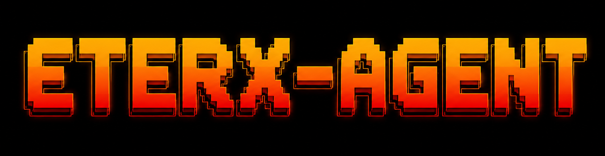

<p align="center">
  
</p>

<h1 align="center">EterX-Agent</h1>

<p align="center">
  <strong>An adaptive AI companion designed to run workflows, manage tasks, and coordinate intelligent workspace actions.</strong>
</p>

<p align="center">
  
  
</p>

---

## What is EterX?

EterX is an autonomous agent workspace that goes beyond simple conversation. It is designed to act as an assistant that can take high-level requests, figure out the necessary steps, coordinate specialized helper agents, and interact with files and applications to get real work done.

The system runs locally on your machine, ensuring your data, history, and workspace configurations remain entirely private.

---

## Core Capabilities

### Collaborative Sub-Agents
For complex projects, the main agent does not work in isolation. It can delegate tasks to specialized sub-agents running concurrently in the background. These helper agents collaborate using a built-in messaging mailbox system, sharing progress, debating choices, and working together to compile the final result.

### Intelligent Model Routing
EterX dynamically manages how it communicates with different AI models. It automatically determines the best model for the task at hand and handles connection issues or model availability behind the scenes with a silent fallback system. It also supports load balancing across multiple API keys to prevent interruptions.

### Custom Agent Builder
Design and train custom personas for specific responsibilities. The Agent Builder lets you construct new agents with distinct missions, safety guidelines, and tailored toolsets, creating specialized assistants ready for your workspace.

### Secure Local Execution
Run scripts, compile code, and test designs in a secure, sandboxed local environment. The agent can verify its own output safely without risking your main system files.

### Continuous Memory & Context
EterX learns from your work patterns and retains context across sessions. It maps out learned concepts over time, allowing it to remember past decisions, project details, and your preferences naturally without needing constant reminders.

---

## The Workspace Experience

### Cross-Platform Access
Engage with your agent through a web interface, a dedicated desktop application, or remotely via a Telegram bot when you are away from your computer.

### Modern UI & Custom Themes
A clean, premium design supporting light and dark themes to match your preferred workflow aesthetic.

---

## Installation

### One-Command Install

**Windows (PowerShell):**
```powershell
irm https://raw.githubusercontent.com/harshilsoni5666/EterX-agent-/main/install.ps1 | iex
```

**Linux / macOS:**
```bash
curl -fsSL https://raw.githubusercontent.com/harshilsoni5666/EterX-agent-/main/install.sh | bash
```

### Manual Install

```bash
git clone https://github.com/harshilsoni5666/EterX-agent-.git
cd EterX-agent-
node setup.js
```

---

## Quick Start & Usage

Configure your API keys:
```bash
eterx api
```

Launch the workspace environment:

| Environment | CLI Command |
|-------------|-------------|
| Web App | `eterx start` |
| Desktop App | `eterx desktop` |
| Telegram Bot | `eterx telegram` |

---

## CLI Commands

EterX provides a command-line utility to control your workspace:

*   `eterx setup` / `eterx api` - Full system configuration and key entry
*   `eterx doctor` / `eterx health` - System diagnosis and live API tests
*   `eterx status` / `eterx logs` - View environment configurations and setup history
*   `eterx backup` / `eterx restore` - Save or recover your configurations and memory
*   `eterx clean` - Clear temporary files and caches

---

## Developer

Currently under development.

Built by Harshil Soni.
