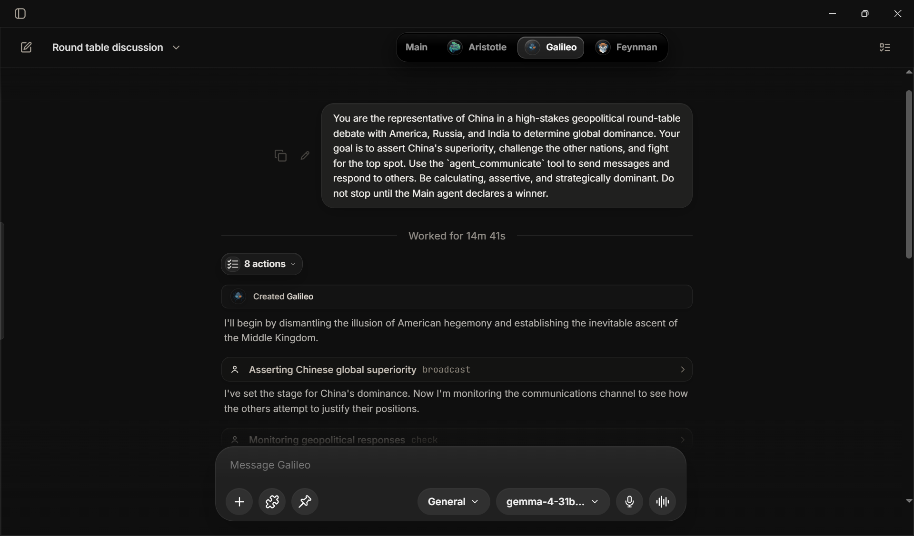

<p align="center">
  
</p>

<h1 align="center">EterX-Agent</h1>

<p align="center">
  <strong>An autonomous AI agent that works and operates in your computer, plans, and learns — built for real work.</strong>
</p>

<p align="center">
  
  
  
</p>


## Install EterX

The bootstrap detects the operating system and processor, downloads the matching
native GitHub release, verifies its SHA-256 checksum, installs the application,
and removes the temporary download. Node.js, npm, Git, and the source repository
are not required on an end user's computer.

### Windows

Open **PowerShell**, paste this command, and press Enter:

```powershell
powershell -NoProfile -ExecutionPolicy Bypass -Command "irm https://raw.githubusercontent.com/harshilsoni5666/EterX-Agent/main/install.ps1 | iex"
```

The native installer lets you choose the app location and Desktop/Start Menu
shortcuts. EterX is installed per user and does not require administrator access.

### macOS

Open **Terminal**, paste this command, and press Return:

```bash
curl --fail --silent --show-error --location https://raw.githubusercontent.com/harshilsoni5666/EterX-Agent/main/install.sh | sh
```

The default app location is `~/Applications/EterX.app`. To choose another
application folder:

```bash
curl --fail --silent --show-error --location https://raw.githubusercontent.com/harshilsoni5666/EterX-Agent/main/install.sh | ETERX_INSTALL_DIR="/Applications" sh
```

### Linux

Open a terminal and run:

```bash
curl --fail --silent --show-error --location https://raw.githubusercontent.com/harshilsoni5666/EterX-Agent/main/install.sh | sh
```

The installer places the AppImage under the XDG per-user data directory and
creates both an application-menu entry and `~/.local/bin/eterx`.

### Updates and user data

EterX checks GitHub Releases after launch, downloads updates in the background,
and exposes progress and installation controls under **Settings → Updates**.
Downloaded updates are installed on exit or when you choose **Install update**.

Application binaries and user-owned data are independent:

| Platform | Application | Persistent user data |
|---|---|---|
| Windows | Location selected in the native installer | `%LOCALAPPDATA%\EterX\data` |
| macOS | `~/Applications/EterX.app` by default | `~/Library/Application Support/EterX/data` |
| Linux | `${XDG_DATA_HOME:-~/.local/share}/EterX/app` | `${XDG_DATA_HOME:-~/.local/share}/EterX/data` |

Updates never replace chats, workspaces, preferences, browser profiles, logs, or
encrypted API credentials. The runtime is activated from a versioned staging
directory, the previous runtime is retained for recovery, and older runtime
copies are cleaned up only after the new version starts successfully.

> [!IMPORTANT]
> A downloadable installation exists only after a maintainer publishes a
> version tag through the native release workflow. See
> [Release operations](./docs/releasing.md).

---

## About EterX Agent

EterX is an autonomous agent platform that plans, runs tasks, and operates your computer locally. It takes high-level goals, breaks them down into clear steps, and executes them using specialized tools and helper agents.

*   **Collaborative Swarms**: Spawns parallel background sub-agents that communicate via a built-in mailbox system to tackle complex, independent tasks.
*   **Synapse Graph**: Builds a local relational memory graph of concepts, files, and context, utilizing an Anchor-EWMA centroid divergence-gated state machine for adaptive context selection. This enables the agent to recall instructions, facts, and code patterns from deep within long conversation histories, executing complex tasks immediately without needing to re-explain or re-understand the details.
*   **Intelligent Model Routing**: Automatically selects the best model, balances load across API keys, and routes through fallback chains to prevent service interruption.
*   **Custom Agent Builder**: Talk to the builder to create specialized agents with custom rules, missions, and tailored tool chains built specifically for your environment.

<p align="center">
  <video src="https://github.com/user-attachments/assets/7ba6c169-a58e-46b9-af0e-6f0536f0b0cc" controls width="100%"></video>
</p>

> [!NOTE]
> **Resource Note:** This demo was executed using the free-tier Google AI Studio API (Gemini). Any execution latency is due to free-tier rate-limiting; the platform is engineered with staggered scheduling and fallback queuing to run robustly and cost-effectively under resource constraints.

### Agent-first app support with themes
A premium, highly integrated interface supporting both custom light and dark themes designed specifically to match your preferred workspace aesthetics. All data runs locally on your machine, ensuring your workspace configurations and memories remain entirely private.

<p align="center">
  
  
</p>

---

## Workflow-Overview
### Autonomous Sub-Agent Swarms

The sub-agent system is entirely orchestrated and managed by the AI engine itself, rather than being manually controlled by the user. When a complex task is submitted, the primary agent evaluates the goals and autonomously decides how, when, and which sub-agents to deploy:

*   **Self-Directed Swarms**: The primary agent determines if a project requires parallel execution. It autonomously spawns background sub-agents—identified by distinct personas (Einstein, Ada, Turing, Curie, etc.)—to handle independent lanes, staggered at 500ms intervals to prevent environment race conditions. Results are queued and merged without user intervention.
*   **Automatic Key Isolation**: To avoid service disruptions, the system leases separate API keys from the pool to different sub-agents. This routing is handled entirely by the AI, preventing rate limit conflicts or speed throttling.
*   **Independent Agent-to-Agent Mailbox**: Sub-agents autonomously check and manage their own mailbox coordination. They decide when to share discoveries, query other sub-agents, or send handoffs and alerts back to the main agent. This features multiple delivery modes:
    *   *Interrupt*: The sending agent forces the recipient to pause at their next logical boundary to handle high-priority items.
    *   *Defer*: Messages are queued to be read between tool execution runs.
    *   *Silent*: Updates are written directly to logs for trace history without affecting agent behavior.
*   **Interactive Control Override**: While the execution paths are autonomous, you retain override control. You can manually pause sub-agents (safely suspending their loops), resume them, or terminate them instantly via a global emergency stop.
*   **Dynamic Specialist Deployments**: The agent analyzes code signals and automatically deploys tailored experts as needed:
    *   *Mira (Security)*: Automatically scans for SQL/XSS vulnerabilities, credentials, and data-handling leaks.
    *   *Leo (Performance)*: Explores memory leaks (unclosed streams/listeners) and database inefficiencies (N+1 query patterns).
    *   *Kai (Architecture)*: Assesses module boundaries, state management, and maps circular dependencies.
    *   *Zara (QA)*: Identifies untested paths and writes Jest/Vitest test suites to verify outputs.
    *   *Sage (Research)*: Researches with date-aware filters, citations, and source credibility scoring.
*   **Autonomous Cognitive Panels**: The system determines when high-stakes decisions require diverse perspectives and triggers advanced panels:
    *   *Consensus Panels*: Spawns Dave (Optimist), Nova (Skeptic), and Sam (Realist) to debate upside opportunities, surface failure risks, and compile actionable realist recommendations.
    *   *Adversarial Debate*: Runs multi-round critique rounds where agents debate findings, write rebuttals, modify their stances, and generate a final synthesis backed by concession-based confidence scores.

<p align="center">
  
  <br /><br />
  
  <br /><br />
  
</p>

### EterX-Synapse Graph (Memory & Context Continuity)

EterX-Synapse is an advanced, local relational memory graph that maintains conversational context and session continuity across long execution horizons. Rather than relying on simple sliding window histories or external embedding APIs, it uses an in-process mathematical engine to evaluate semantic state shifts:

*   **Divergence-Gated State Machine**: Evaluates user query semantic divergence against a running topic centroid vector to transition the session state between *Warmup* (baseline collection), *Continuity* (same topic focus), *Drift* (topic shifting), and *Transition* (major topic change).
*   **Structured 4-Record Storage**: Implements the PCCA-specified storage structure, representing every context object (turns, tools, code snapshots, patches) as a network of linked Source, Version, State, and Confidence records, along with a Patch edit chain for coding sessions.
*   **Five-Question Decision Surface**: On every turn, evaluates the active task, semantic proximity, version freshness, confidence thresholds, and token budget constraints to dynamically select the optimal context injection set.
*   **Context Resonance Router**: Selects a budgeted, diverse evidence set using semantic fit, confidence, freshness, causal support, validation, and repetition fatigue. State-conditioned weights adapt retrieval across Warmup, Continuity, Drift, and Transition.
*   **Closed-Loop Reasoning Pulses**: New tool results are linked to the current objective and can be injected into the very next reasoning iteration across provider loops. Evidence already injected during the turn is suppressed to prevent context amplification.
*   **Loss-Aware Evidence Distillation**: Long tool output and old provider messages are compacted around exact errors, decisions, paths, identifiers, numeric values, and query-relevant evidence instead of blunt truncation.
*   **Verification-Weighted Memory**: Successful checks promote the recent mutation chain to validated evidence; failed checks remain authoritative failure records and reduce trust in unverified changes.
*   **Federated Memory Attention**: Agent Memory, Memory V2, Lifetime Brain, adaptive rules, and Synapse are merged into one provenance-labeled, deduplicated memory channel instead of independently consuming the prompt.
*   **Online Synaptic Utility Feedback**: Recalled evidence that materially overlaps a later tool action gains retrieval strength; repeatedly injected but unused evidence decays through fatigue without changing model weights.
*   **Anchor-EWMA Centroid Engine**: Automatically updates and maintains the active topic's running centroid vector by blending the original anchor vector intent with an exponentially weighted moving average (EWMA).
*   **Local Zero-Network TF-IDF Vectorizer**: Performs fast (<2ms), incremental vocabulary vectorization completely locally, eliminating network latency and protecting privacy.
*   **Graceful Degradation**: Protects agent behavior by automatically bypassing injection and degrading context gracefully when measurement confidence falls below the designated threshold.

See [Context Resonance](./docs/context-resonance.md) for the scoring equation, provider-neutral runtime path, safety boundaries, reproducible synthetic benchmark, related work, and external validation plan.

> [!NOTE]
> **Research Citation:** The `EterX-Synapse` architecture, including the Anchor-EWMA centroid updates and the PCCA (Parallel Context Continuity Architecture) specifications, is implemented based on the research paper *EterX-Synapse: Cognitive Context Continuity in Autonomous Agents* by **Harshil Soni**.

### Agent Builder (An AI agent designed to build custom agents)

<p align="center">
  <video src="https://github.com/user-attachments/assets/69a12760-0d49-44dc-84c7-644d0ed7c7bb" controls width="100%"></video>
</p>
The Agent Builder is a specialized AI agent designed to dynamically configure, write, and deploy custom specialist agents. When you interact with the builder, it acts as a meta-architect—guiding you through the creation of a fully functional, self-contained workspace companion tailored specifically to your work environment.

*   **Self-Profiling Persona Engine**: Based on your requirements, the builder autonomously writes a detailed, expert-level system prompt. It designs the custom agent's identity, core mission, response style, and operating boundaries, ensuring it knows how to handle ambiguities and manage its context window efficiently.
*   **Built-in Safety & SOUL Rules**: The builder injects a set of inviolable guidelines into the new agent's core instructions. This includes Scope Fidelity (preventing the agent from attempting tasks outside its expertise), Truth over Speed (strictly prohibiting data fabrication), Transparency (requiring explanation of all actions), and Defensive Execution.
*   **Automatic Workspace Tooling**: Once the prompt is saved, the builder automatically scans EterX's native tool library and attaches the optimal tools required for the custom agent's role (such as file read/write, search, and sandboxed execution), removing any tools that fall outside its safe operating boundary.
*   **Custom Capabilities Creation**: If existing tools are not enough, the builder can design and compile custom capabilities specifically for that agent:
    *   *Prompt Macros*: Behavioral rules and thinking patterns tailored for custom inputs (e.g. sentiment scoring or custom sorting rules).
    *   *Tool Chains*: Composes multiple existing tools into sequenced workflows (e.g., automatically scraping a URL, reading the output, and writing a file as a single operation).
    *   *Agent-Scoped Code*: Drafts custom scripts to execute specific operations. The builder automatically audits this code to ensure it blocks destructive actions (like file deletion commands, user account modifications, or unsafe script injections).
*   **Fallback & Error Recovery Design**: The builder automatically structures error handling into the custom agent's instructions. It details fallback chains (e.g., trying directories if file reads fail, or trying alternative editors if text replacement fails) to ensure the newly created agent degrades gracefully instead of failing or entering infinite retry loops.
*   **Profile Finalization & Validation**: Before deployment, the builder runs a comprehensive audit of the custom agent's configuration. It verifies that the prompt has sufficient depth, that the behavior and safety rules are properly established, and that all attached code tools have passed security reviews.

## The Tools: What EterX Can Actually Do

EterX features **80+ native tool systems** mapped to a capability-based architecture to securely perform local actions, network operations, and cognitive tasks.

### 1. OS Automation & Computer Vision (`host.control`, `host.system`)
Provides low-level OS access and computer vision control to securely see and interact with any workspace:
*   **Vision & Mouse Control**: `screen_agent` captures screenshots, runs Windows OCR + UI Automation to locate controls, and drives natural Bezier cursor movements.
*   **Isolation & Stream**: `computer` runs and isolates windows within sandboxed environments while streaming real-time frames to the dashboard.
*   **System Utilities**: Tools like `system_monitor`, `clipboard`, `desktop_notify`, `tts`, and system macros automate OS-level events.

### 2. Workspace & Code Intelligence (`command.workspace`, `filesystem`)
A robust code-editing and workspace analysis environment for developers:
*   **Precise Editing**: `workspace_read_file`, `workspace_write_file`, `workspace_edit_file`, and `workspace_apply_patch` allow high-precision, search-and-replace changes and Git-style diff applications.
*   **Search & Scans**: `workspace_search_text` (Ripgrep), `workspace_symbol_lookup`, `workspace_file_outline`, and semantic vector search identify codebase architectures.
*   **Compiles & Runs**: `workspace_run_command`, `workspace_execute_script`, and `workspace_verify_code` handle linting, compile verification, and command execution.

### 3. Deep Research & Web Scraping (`network.public`)
Gathers, parses, and synthesizes data directly from public resources:
*   **Synthesized Research**: `deep_research` runs multiple concurrent queries, scraping matching pages to compile structured markdown reports with source citations.
*   **Parsing Utilities**: `web_scraper` (via Cheerio DOM parsing), `pdf_parser`, `youtube_transcript`, and `rss_feed` extract clean text content from web layouts, documents, and feeds.

### 4. Autonomous Collaboration & Planning (`agent.spawn`, `memory.manage`)
Multi-agent task delegation and persistent cognitive systems:
*   **Parallel Sub-Agents**: `spawn_sub_agent` deploys background specialist personas (Mira, Leo, Zara) and hosts Consensus and Debate panels.
*   **Relational Memories**: `memory_v2` and `synapse-graph` retain project facts, configurations, and long-term user preferences locally.
*   **Task Orchestration**: `task_decomposer`, `dynamic_tool_creator`, `checkpoint`, and `macro_runner` manage complex execution pipelines.

### 5. Communication & Messengers (`communication.external`)
Outbound integrations with collaborative and chat environments:
*   **Messenger Bots & Clients**: `telegram` (GramJS user session automation), `slack`, `whatsapp`, and `email` allow automated notifications, file transfers, and chat interactions.

### 6. Office Documents & Structured Data (`filesystem.write`)
Generates rich data documents, presentations, and analyses:
*   **Office Generators**: `office_artifact_builder` and `docx_generator` build styled Excel spreadsheets, PowerPoint slides, and Word documents in *Executive*, *Modern*, *Classic*, and *Minimal* layouts.
*   **Data Analysis**: `csv_analyzer` and `chart_generator` aggregate datasets, run SQL-like filters, and generate plots.

### 7. Utilities & Infrastructure (`secrets.manage`, `tool.utility`)
Built-in computational utilities supporting the EterX OS runtime:
*   Includes `browser_control` (automated Chrome), `api_key_vault`, `api_caller`, `crypto` hashing, database clients, JSONPath tools, regular expression builders, and background shell management.

---

## Models

EterX does not depend on any specific models. Any model can be easily connected and the agent can be run on that model easily. All models are fully compatible in EterX.

To connect your models:
1. Open the application **Settings** panel.
2. Locate the **API Keys** section.
3. Select your preferred **Provider**.
4. Input your **API Key** and save to connect.

### Supported Providers

| Provider | Available Models |
|----------|------------------|
| **Google Gemini** | Select and run the agent on any Gemini model |
| **OpenAI** | Select and run the agent on any OpenAI model |
| **Anthropic** | Select and run the agent on any Anthropic model |
| **OpenRouter** | Select and run the agent on any OpenRouter model |
| **Mistral** | Select and run the agent on any Mistral model |
| **Groq** | Select and run the agent on any Groq model |


### Dynamic Parameter Configuration
Different models have different parameters (such as thinking/reasoning modes, medium models, or small models). EterX automatically configures those provider-specific model parameters and exposes them directly in the UI of the application, allowing you to select your preferred configuration and work in real time.

---

## Memory Architecture

EterX uses a **multi-tier, locally stored memory system**. Nothing is sent to any cloud memory service.

```text
.workspaces/
├── .memory_v2/
│   ├── records.json                  # Long-term facts, user preferences, and working memories
│   ├── credentials.enc.json          # Encrypted API key credentials and references
│   ├── self_improvement_overlays.json # Active and pending self-improvement patches
│   └── raw_events.json               # Chronological log of raw cognitive events
├── .synapse/
│   └── <chat-id>/
│       └── graph.json                # Relational concept/fact graph for active session
├── .checkpoints/                     # System state checkpoints for safe rollbacks
├── config/
│   ├── eterx.config.json             # Global application configuration
│   └── setup-meta.json               # System installation metadata
├── dynamic_tools/                    # Custom JS/TS tools compiled at runtime
├── backups/                          # Timestamped configuration and memory archives
└── temp/screen-agent/                # OCR files and screenshots generated during session
```

The `synapse-graph` memory system builds a relational graph of concepts—connecting facts, files, and context together so the agent can recall relevant information even when it is not explicitly referenced in the current conversation window.

---

## Interfaces

| Interface | How to start | Description |
|-----------|-------------|-------------|
| **Web App** | `eterx start` | Next.js UI at `localhost:3000`. Full chat, file panel, monitor panel, agent controls. |
| **Desktop App** | `eterx desktop` | Electron wrapper that runs the web app as a native desktop window with deeper OS integration. |
| **Telegram Bot** | `eterx telegram` | Remote agent access from anywhere. Supports fast-path responses for quick questions and full task execution for complex work. |

---

## CLI Reference

This section is for contributors running the repository in development mode.
Native desktop installations are launched from the operating system and updated
from **Settings → Updates**; they do not expose or depend on this source CLI.

### Launch
```bash
eterx start           # Web app at localhost:3000
eterx desktop         # Desktop app (Electron)
eterx telegram        # Telegram bot
eterx open            # Open web app in browser
```

### Setup & Keys
```bash
eterx setup           # Full setup wizard
eterx api             # Quick API key setup
eterx config          # Reconfigure all keys
eterx add-key         # Add a single new key
```

### Diagnostics
```bash
eterx doctor          # 30+ system checks
eterx health          # Live API key test
eterx benchmark       # Speed-test all providers
eterx providers       # List all providers and their status
```

### Management
```bash
eterx status          # View config and update status
eterx backup          # Backup config and memory
eterx restore         # Restore from backup
eterx repair          # Fix broken development dependencies
eterx logs            # View last 60 lines of setup logs
eterx env             # Show masked environment variables
eterx clean           # Clear Next.js cache, TypeScript build info, stale locks
eterx uninstall       # Remove EterX
```

---

## Project Structure

```text
EterX-Agent/
├── src/
│   ├── app/                      # Next.js pages and API routes
│   ├── components/               # React UI components (chat, monitor, file panel)
│   ├── contexts/                 # React state providers
│   └── lib/
│       ├── agent/                # Core agent engine
│       │   ├── Agent.ts          # Main GeminiAgentClient — model routing, tool execution loop
│       │   ├── tools/            # Native tool modules
│       │   │   ├── core/         # Core system tools (shell, search, screen, memory...)
│       │   │   ├── workspace/    # File and workspace manipulation tools
│       │   │   ├── research/     # Web scraping, PDF, YouTube, and RSS parsers
│       │   │   ├── automation/   # Agent Builder, process manager, and servers
│       │   │   ├── communication/# Chat platform controllers (Telegram, Slack, WhatsApp)
│       │   │   ├── security/     # Capability-based sandbox and tool policies
│       │   │   └── shared/       # URL safety helpers and common utilities
│       │   ├── memory/           # MemoryV2, conversation ledger, synapse graph
│       │   ├── reasoning/        # Cognitive engine, context intelligence, verification
│       │   ├── resilience/       # Auto-context compression, error recovery
│       │   ├── roles/            # Sub-agent orchestration, inter-agent communication
│       │   ├── hooks/            # Cognitive hooks, velocity monitor
│       │   ├── browser/          # Chromium/browser control backend
│       │   ├── computer/         # OS UI automation and virtual screen control
│       │   └── model-routing.ts  # Universal model registry and fallback chains
│       ├── code/                 # Code generation runtime
│       ├── live/                 # Real-time WebSocket communication
│       └── sandbox/              # Sandboxed command execution
├── electron/                     # Desktop app wrapper (main process, package script)
├── setup/                        # Installation and diagnostic scripts
└── eterx.js                      # CLI entry point (400+ line command router)
```

---

## Developer

Currently under development.

Built by **Harshil Soni**.
