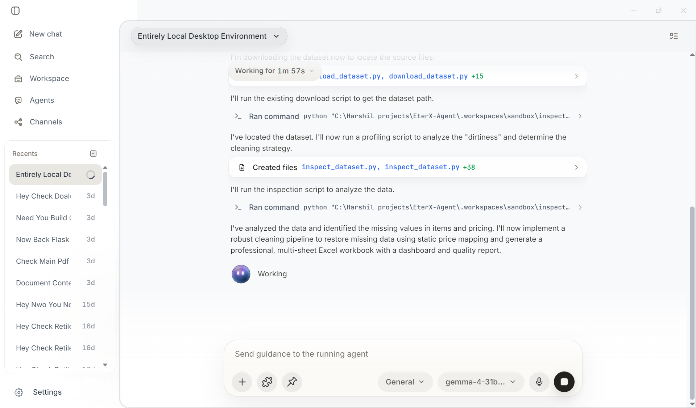
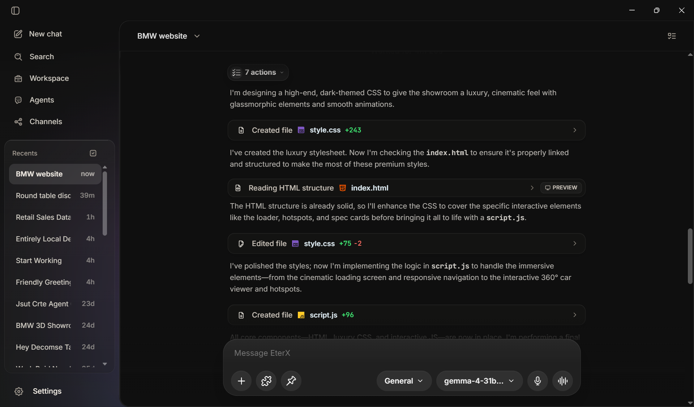
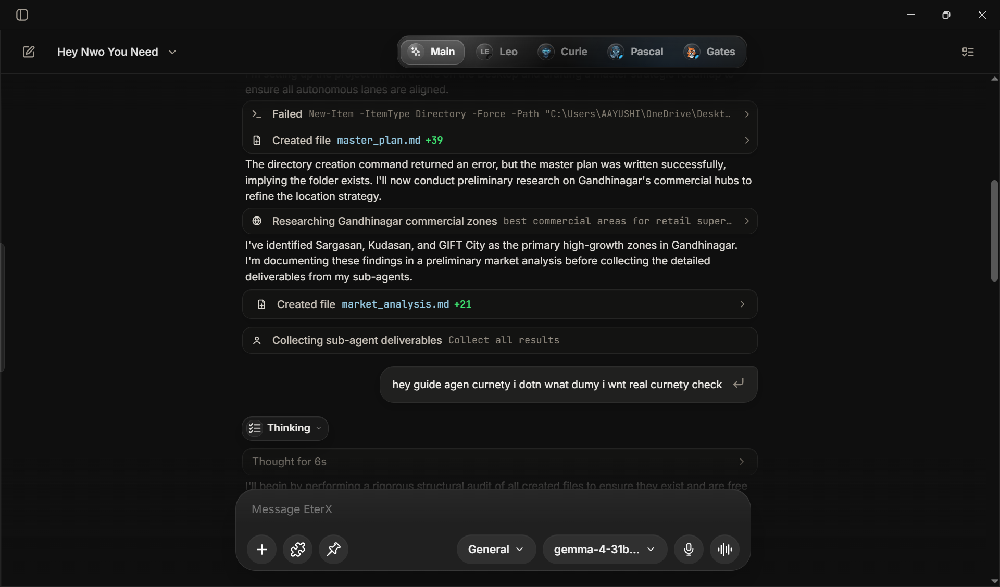
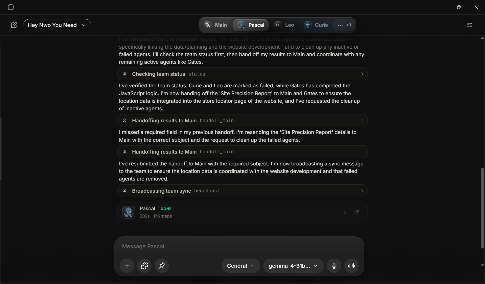

<p align="center">
  
</p>

<h1 align="center">EterX-Agent</h1>

<p align="center">
  <strong>An autonomous AI agent that works and operates in your computer, plans, and learns — built for real work.</strong>
</p>

<p align="center">
  
  
  
</p>

---

## About EterX Agent

EterX is an autonomous agent platform that plans, runs tasks, and operates your computer locally. It takes high-level goals, breaks them down into clear steps, and executes them using specialized tools and helper agents.

*   **Collaborative Swarms**: Spawns parallel background sub-agents that communicate via a built-in mailbox system to tackle complex, independent tasks.
*   **Intelligent Model Routing**: Automatically selects the best model, balances load across API keys, and routes through fallback chains to prevent service interruption.
*   **Custom Agent Builder**: Talk to the builder to create specialized agents with custom rules, missions, and tailored tool chains built specifically for your environment.

### Agent-first app support with themes
A premium, highly integrated interface supporting both custom light and dark themes designed specifically to match your preferred workspace aesthetics. All data runs locally on your machine, ensuring your workspace configurations and memories remain entirely private.

<p align="center">
  
  
</p>

---

## Workflow-Overview
### Autonomous Sub-Agent Swarms

The sub-agent system is entirely orchestrated and managed by the AI engine itself, rather than being manually controlled by the user. When a complex task is submitted, the primary agent evaluates the goals and autonomously decides how, when, and which sub-agents to deploy:

*   **Self-Directed Swarms**: The primary agent determines if a project requires parallel execution. It autonomously spawns background sub-agents—identified by distinct personas (Einstein, Ada, Turing, Curie, etc.)—to handle independent lanes, staggered at 500ms intervals to prevent environment race conditions. Results are queued and merged without user intervention.
*   **Automatic Key Isolation**: To avoid service disruptions, the system leases separate API keys from the pool to different sub-agents. This routing is handled entirely by the AI, preventing rate limit conflicts or speed throttling.
*   **Independent Agent-to-Agent Mailbox**: Sub-agents autonomously check and manage their own mailbox coordination. They decide when to share discoveries, query other sub-agents, or send handoffs and alerts back to the main agent. This features multiple delivery modes:
    *   *Interrupt*: The sending agent forces the recipient to pause at their next logical boundary to handle high-priority items.
    *   *Defer*: Messages are queued to be read between tool execution runs.
    *   *Silent*: Updates are written directly to logs for trace history without affecting agent behavior.
*   **Interactive Control Override**: While the execution paths are autonomous, you retain override control. You can manually pause sub-agents (safely suspending their loops), resume them, or terminate them instantly via a global emergency stop.
*   **Dynamic Specialist Deployments**: The agent analyzes code signals and automatically deploys tailored experts as needed:
    *   *Mira (Security)*: Automatically scans for SQL/XSS vulnerabilities, credentials, and data-handling leaks.
    *   *Leo (Performance)*: Explores memory leaks (unclosed streams/listeners) and database inefficiencies (N+1 query patterns).
    *   *Kai (Architecture)*: Assesses module boundaries, state management, and maps circular dependencies.
    *   *Zara (QA)*: Identifies untested paths and writes Jest/Vitest test suites to verify outputs.
    *   *Sage (Research)*: Researches with date-aware filters, citations, and source credibility scoring.
*   **Autonomous Cognitive Panels**: The system determines when high-stakes decisions require diverse perspectives and triggers advanced panels:
    *   *Consensus Panels*: Spawns Dave (Optimist), Nova (Skeptic), and Sam (Realist) to debate upside opportunities, surface failure risks, and compile actionable realist recommendations.
    *   *Adversarial Debate*: Runs multi-round critique rounds where agents debate findings, write rebuttals, modify their stances, and generate a final synthesis backed by concession-based confidence scores.

<p align="center">
  
  
</p>

### Agent Builder (An AI agent designed to build custom agents)

<p align="center">
  <video width="100%" controls>
    <source src="https://github.com/harshilsoni5666/EterX-Agent/raw/fix/clearing-files/public/assets/Agent-Builder.mp4" type="video/mp4">
    Your browser does not support the video tag.
  </video>
</p>


The Agent Builder is a specialized AI agent designed to dynamically configure, write, and deploy custom specialist agents. When you interact with the builder, it acts as a meta-architect—guiding you through the creation of a fully functional, self-contained workspace companion tailored specifically to your work environment.


*   **Self-Profiling Persona Engine**: Based on your requirements, the builder autonomously writes a detailed, expert-level system prompt. It designs the custom agent's identity, core mission, response style, and operating boundaries, ensuring it knows how to handle ambiguities and manage its context window efficiently.
*   **Built-in Safety & SOUL Rules**: The builder injects a set of inviolable guidelines into the new agent's core instructions. This includes Scope Fidelity (preventing the agent from attempting tasks outside its expertise), Truth over Speed (strictly prohibiting data fabrication), Transparency (requiring explanation of all actions), and Defensive Execution.
*   **Automatic Workspace Tooling**: Once the prompt is saved, the builder automatically scans EterX's native tool library and attaches the optimal tools required for the custom agent's role (such as file read/write, search, and sandboxed execution), removing any tools that fall outside its safe operating boundary.
*   **Custom Capabilities Creation**: If existing tools are not enough, the builder can design and compile custom capabilities specifically for that agent:
    *   *Prompt Macros*: Behavioral rules and thinking patterns tailored for custom inputs (e.g. sentiment scoring or custom sorting rules).
    *   *Tool Chains*: Composes multiple existing tools into sequenced workflows (e.g., automatically scraping a URL, reading the output, and writing a file as a single operation).
    *   *Agent-Scoped Code*: Drafts custom scripts to execute specific operations. The builder automatically audits this code to ensure it blocks destructive actions (like file deletion commands, user account modifications, or unsafe script injections).
*   **Fallback & Error Recovery Design**: The builder automatically structures error handling into the custom agent's instructions. It details fallback chains (e.g., trying directories if file reads fail, or trying alternative editors if text replacement fails) to ensure the newly created agent degrades gracefully instead of failing or entering infinite retry loops.
*   **Profile Finalization & Validation**: Before deployment, the builder runs a comprehensive audit of the custom agent's configuration. It verifies that the prompt has sufficient depth, that the behavior and safety rules are properly established, and that all attached code tools have passed security reviews.

---

## End-to-End Workflow

EterX is organized around a seamless, end-to-end workflow that connects model configuration, customized personas, and multi-agent execution:

*   **Configure Providers and Models**: Select your preferred AI provider (Google Gemini, OpenAI, Anthropic, OpenRouter, etc.) and pick the specific models you want to use. EterX manages these connections, handles load balancing across multiple API keys, and automatically routes tasks to stable fallback models if a primary model is down.
*   **Create Tailored Custom Agents**: Use the interactive Agent Builder to design custom agents. You can talk to the builder to establish their mission and behavior rules, and the system will automatically configure a custom chain of tools and helpers specifically for that agent's work environment.
*   **Delegate Tasks to Collaborative Sub-Agents**: Initiate your workflow and let the main agent break down complex tasks. It can spawn specialized sub-agents in the background that work in parallel and communicate via an inter-agent mailbox system to coordinate and assemble the final output.
*   **Execute Local Workspace Actions**: Let your agents interact directly with your workspace. They can safely read and edit files, execute commands in isolated local sandboxes, conduct deep multi-angle web research, and use the computer cursor naturally to complete your instructions.
*   **Retain Memory and Relational Context**: When a workflow finishes, EterX persists the learnings, facts, and project details locally. This feeds into a continuous learning loop, making all future tasks faster and context-aware.

---

## The Tools: What EterX Can Actually Do

EterX ships with **80+ native tools** organized into categories. These are not wrappers — each tool is a purpose-built capability.

### Computer & Screen Control
The `screen_agent` tool gives EterX full, real human-like control of your computer:
- Takes screenshots and **sees** the screen
- Clicks with natural bezier cursor movement (not robotic straight lines)
- Types with human-like timing and per-character delays
- Reads text from the screen using Windows OCR + UI Automation
- Finds any UI element by name or text, even if coordinates are unknown
- Waits for visual changes or text to appear before continuing
- Streams the live screen in real time to the monitor panel

### Code Intelligence & File Operations
- `workspace_read_file`, `workspace_write_file`, `workspace_edit_file` — file read/write with patch-level precision
- `smart_refactor` — AI-assisted code restructuring
- `code_intel`, `workspace_symbol_lookup`, `workspace_file_outline` — understand any codebase structure
- `workspace_apply_patch` — apply git-style unified diffs to files
- `workspace_run_command`, `workspace_execute_script`, `workspace_verify_code` — run and verify code in your project
- `git`, `git_intel` — full git operations and intelligence

### Deep Research
- `deep_research` — multi-angle parallel research engine: runs several search queries simultaneously, scrapes top results, synthesizes into a structured report with sources
- `web_search`, `web_scraper`, `pdf_parser`, `youtube_transcript`, `rss_feed` — pull information from any source

### Communication & Messaging
- `telegram` — send messages, control conversations, interact with the Telegram Bot interface
- `slack` — post to channels, react to messages, manage Slack workflows
- `whatsapp` — control WhatsApp via the controller tool
- `email` — send emails programmatically

### Data & Documents
- `chart_generator` — generate data visualizations and charts
- `csv_analyzer` — parse and analyze spreadsheet data
- `docx_generator` — create Word documents
- `office_artifact_builder` — build professional Excel spreadsheets, PowerPoint presentations, and office documents
- `markdown`, `compression`, `diff` — markdown processing, file compression, and comparison

### System & Automation
- `shell`, `terminal_access`, `background_task`, `terminal_background` — run any terminal command, including long-running background processes with scheduled check-ins
- `process_manager`, `file_watcher`, `http_server` — manage system processes, watch files for changes, spin up local HTTP servers
- `sys_automation`, `desktop_control` — OS-level automation
- `system_monitor` — monitor CPU, memory, disk, and process health

### Intelligence & Self-Improvement
- `self_improve` — the agent can write and apply improvement patches to its own skill system
- `memory_v2` — store and recall facts, project context, and session state
- `task_decomposer` — break large goals into organized, independent subtasks
- `realtime_verify` — verify information from live web sources before accepting it as fact

### AI Infrastructure
- `image_gen` — generate images via AI
- `tts` — text-to-speech output
- `calculator`, `js_runner`, `regex`, `json_transform` — built-in compute utilities
- `crypto` — cryptographic operations
- `database` — interact with databases
- `network` — make HTTP requests and inspect network responses
- `api_caller`, `api_hub` — call any external API
- `api_key_vault` — secure, masked storage for API credentials

---

## Models

EterX does not depend on any specific models. Any model can be easily connected and the agent can be run on that model easily. All models are fully compatible in EterX.

To connect your models:
1. Open the application **Settings** panel.
2. Locate the **API Keys** section.
3. Select your preferred **Provider**.
4. Input your **API Key** and save to connect.

### Supported Providers

| Provider | Available Models |
|----------|------------------|
| **Google Gemini** | Select and run the agent on any Gemini model |
| **OpenAI** | Select and run the agent on any OpenAI model |
| **Anthropic** | Select and run the agent on any Anthropic model |
| **OpenRouter** | Select and run the agent on any OpenRouter model |
| **Mistral** | Select and run the agent on any Mistral model |
| **Groq** | Select and run the agent on any Groq model |


### Dynamic Parameter Configuration
Different models have different parameters (such as thinking/reasoning modes, medium models, or small models). EterX automatically configures those provider-specific model parameters and exposes them directly in the UI of the application, allowing you to select your preferred configuration and work in real time.

---

## Memory Architecture

EterX uses a **multi-tier, locally stored memory system**. Nothing is sent to a cloud memory service.

```text
.workspaces/
├── memory/
│   ├── user_memory.json         # Long-term facts about you and your preferences
│   ├── project_memory/          # Per-project context — what has been done, decisions made
│   ├── session_memory/          # Active session state for continuation
│   ├── credential_refs.json     # API key references (no raw keys stored)
│   └── overlays/                # Self-improvement patches applied over time
├── dynamic_tools/               # Custom tools the agent created during sessions
├── temp/screen-agent/           # Temporary files from screen capture and OCR
├── config/
│   ├── eterx.config.json        # App settings
│   └── setup-meta.json          # Installation metadata
└── backups/                     # Timestamped configuration snapshots
```

The `synapse-graph` memory system additionally builds a relational graph of concepts — connecting facts, files, and context together so the agent can recall relevant information even when it is not explicitly referenced.

---

## Interfaces

| Interface | How to start | Description |
|-----------|-------------|-------------|
| **Web App** | `eterx start` | Next.js UI at `localhost:3000`. Full chat, file panel, monitor panel, agent controls. |
| **Desktop App** | `eterx desktop` | Electron wrapper that runs the web app as a native desktop window with deeper OS integration. |
| **Telegram Bot** | `eterx telegram` | Remote agent access from anywhere. Supports fast-path responses for quick questions and full task execution for complex work. |

---

## Installation

### One-Command Install (Recommended)

**Windows (PowerShell):**
```powershell
irm https://raw.githubusercontent.com/harshilsoni5666/EterX-agent-/main/install.ps1 | iex
```

**Linux / macOS:**
```bash
curl -fsSL https://raw.githubusercontent.com/harshilsoni5666/EterX-agent-/main/install.sh | bash
```

> The installer handles Node.js, Git, dependencies, API key configuration, local storage setup, desktop shortcuts, and launch.

### Manual Install

```bash
git clone https://github.com/harshilsoni5666/EterX-agent-.git
cd EterX-agent-
node setup.js
```

### API Key Setup

After installing, add or update your API keys at any time:
```bash
eterx api
```

---

## CLI Reference

### Launch
```bash
eterx start           # Web app at localhost:3000
eterx desktop         # Desktop app (Electron)
eterx telegram        # Telegram bot
eterx open            # Open web app in browser
```

### Setup & Keys
```bash
eterx setup           # Full setup wizard
eterx api             # Quick API key setup
eterx config          # Reconfigure all keys
eterx add-key         # Add a single new key
```

### Diagnostics
```bash
eterx doctor          # 30+ system checks
eterx health          # Live API key test
eterx benchmark       # Speed-test all providers
eterx providers       # List all providers and their status
```

### Management
```bash
eterx status          # View config and update status
eterx upgrade         # Pull latest and reinstall
eterx backup          # Backup config and memory
eterx restore         # Restore from backup
eterx repair          # Fix broken installation
eterx logs            # View last 60 lines of setup logs
eterx env             # Show masked environment variables
eterx clean           # Clear Next.js cache, TypeScript build info, stale locks
eterx uninstall       # Remove EterX
```

---

## Project Structure

```text
EterX-Agent/
├── src/
│   ├── app/                      # Next.js pages and API routes
│   ├── components/               # React UI components (chat, monitor, file panel)
│   ├── contexts/                 # React state providers
│   └── lib/
│       ├── agent/                # Core agent engine
│       │   ├── Agent.ts          # Main GeminiAgentClient — model routing, tool execution loop
│       │   ├── tools/            # All 80+ native tools
│       │   │   ├── core/         # Core tools (shell, search, screen, memory, sub-agents...)
│       │   │   ├── workspace/    # File and code tools
│       │   │   ├── research/     # Web scraping, PDF, YouTube, RSS
│       │   │   ├── automation/   # Agent Builder, process manager, file watcher
│       │   │   └── communication/# Telegram, Slack, WhatsApp
│       │   ├── memory/           # MemoryV2, conversation ledger, synapse graph
│       │   ├── reasoning/        # Cognitive engine, context intelligence, verification
│       │   ├── resilience/       # Auto-context compression, error recovery
│       │   ├── roles/            # Sub-agent orchestration, inter-agent communication
│       │   ├── hooks/            # Cognitive hooks, velocity monitor
│       │   └── model-routing.ts  # Universal model registry and fallback chains
│       ├── code/                 # Code generation runtime
│       ├── live/                 # Real-time WebSocket communication
│       └── sandbox/              # Sandboxed command execution
├── electron/                     # Desktop app wrapper
├── fastapi_blog/                 # Python FastAPI backend for structured data
├── setup/                        # Installation and diagnostic scripts
└── eterx.js                      # CLI entry point (400+ line command router)
```

---

## Developer

Currently under development.

Built by **Harshil Soni**.
