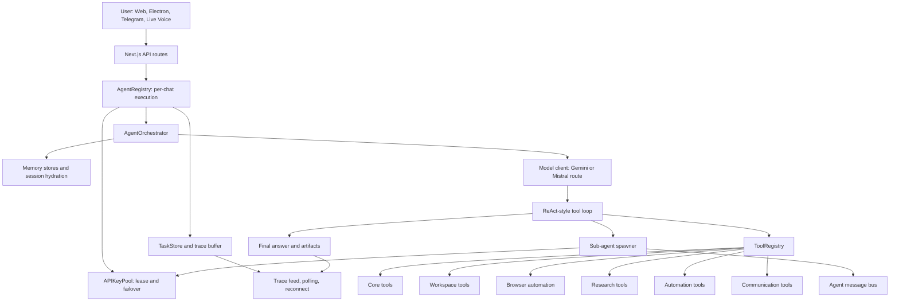

# EterX-Agent: A Local-First, Multi-Interface Runtime for Tool-Orchestrated AI Agents

Author: Harshil Soni  
Project: EterX-Agent  
Draft status: Research paper draft for conference-style submission or project documentation  
Prepared: 2026-05-19

## Authoring and Presentation Target

For a computer-science or AI-agent conference submission, the best target is an IEEE-style full paper of 6-8 formatted pages, because IEEE describes a full conference paper as a complete research description in that range [1]. For this project, the strongest version is an 8-page paper plus references and optional appendix, because the system has enough implementation depth to justify architecture, memory, tool orchestration, multi-agent execution, and deployment sections. If the paper is used as an internal whitepaper instead of a strict conference paper, a 12-16 page version is reasonable.

Recommended page allocation:

| Section | Target length |
| --- | ---: |
| Abstract and keywords | 0.25 page |
| Introduction and contributions | 1 page |
| Related work | 1 page |
| System architecture | 2 pages |
| Implementation details | 1.5 pages |
| Evaluation plan and discussion | 1 page |
| Limitations, ethics, conclusion | 0.75 page |
| References | As required by venue |

IEEE recommends a specific, descriptive title; a single-paragraph abstract up to 250 words; a clear introduction, methods, results/discussion, conclusion, and directly supporting references [2]. For presentation, IEEE notes that most conference talks are 10-20 minutes and should communicate the key message rather than all details [3]. For EterX-Agent, use a 12-slide, 12-15 minute talk: problem, gap, architecture overview, execution loop, memory, tool registry, parallel agents, interfaces, security, evaluation plan, limitations, and demo.

## Abstract

Large language model agents extend ordinary chat systems with planning, memory, tool use, browser interaction, code execution, and long-horizon task continuity. However, practical agent systems still face implementation problems that are underrepresented in high-level agent taxonomies: user-interface disconnection, API-key contention, memory contamination across tasks, unsafe credential handling, tool-result observability, and multi-interface deployment. This paper presents EterX-Agent, a local-first AI-agent runtime implemented as a Next.js and Electron application with Telegram and live-voice extensions. The system combines a per-chat agent registry, an LLM-driven ReAct-style tool loop, persistent session and long-term memory, a large typed tool registry, browser automation, workspace manipulation, automation tools, communication tools, and fire-and-forget sub-agents coordinated through isolated API-key leases. A static implementation analysis of the repository identifies approximately 85,268 non-dependency source and documentation lines, 23 application API routes, 75 markdown skill files, and 76 typed tool definitions. The main contribution is not a new foundation model, but a full-stack agent operating environment that bridges natural-language intent and local computation while preserving traceability, reconnectability, and scoped memory. The paper positions EterX-Agent relative to common agent patterns from ReAct, tool-learning, multi-agent frameworks, lifelong skill libraries, and memory-based agents, then distinguishes the project-specific mechanisms developed in this codebase. Finally, it proposes a reproducible evaluation plan covering task success, tool reliability, memory safety, concurrency, reconnection, and human-facing usability.

Keywords: AI agents, LLM agents, tool use, ReAct, agent orchestration, memory, multi-agent systems, local-first AI, browser automation.

## 1. Introduction

AI-agent systems have moved beyond single-turn text generation. Modern agents combine a foundation model with planning, memory, tool calls, code execution, search, file operations, browser control, and feedback from external environments. Recent surveys describe agent systems in terms of LLM cores, memory, planners, tool routers, critics, world models, and orchestration patterns spanning single-agent and multi-agent execution [4]. Other surveys identify planning, memory, and tool use as central components of LLM-based artificial intelligence agents [5]. EterX-Agent sits directly inside this design space, but its implementation emphasis is practical: it attempts to make a local desktop/web/Telegram agent survive long-running work, switch between chats, access local files, automate browser tasks, store scoped memory, and coordinate parallel agents without losing state.

The project is implemented as a TypeScript/JavaScript application using Next.js, Electron, React, and a Node.js backend. It includes a custom agent loop around model function calling, a large local tool registry, persistent memory stores, a task store, a browser automation engine, Telegram bot integration, live voice support, setup/installer utilities, and a UI designed for trace visibility. The repository analysis performed for this paper found 134 TypeScript files, 27 TSX files, 19 JavaScript files, 78 markdown files, and about 85,268 non-dependency lines across source, setup, configuration, documentation, and skills. The system exposes 23 Next.js API route files and defines 76 typed tools across core, workspace, research, automation, and communication categories.

This paper answers three research questions:

RQ1: How can a local-first LLM agent preserve long-horizon task continuity without contaminating new user requests with stale memory?

RQ2: How can one runtime coordinate model calls, local tools, browser automation, documents, communication channels, and parallel sub-agents across multiple user interfaces?

RQ3: Which parts of EterX-Agent are common in the AI-agent literature, and which are project-specific implementation contributions?

The paper makes four contributions:

1. It documents EterX-Agent as a full-stack AI-agent runtime rather than a prompt-only wrapper.
2. It separates common agent patterns from codebase-specific design choices.
3. It provides an implementation-level architecture map covering orchestration, memory, tools, browser automation, UI, Telegram, live voice, and installation.
4. It proposes a professional evaluation plan suitable for turning the project into a stronger empirical research submission.

## 2. Background and Related Work

### 2.1 Agent Components

Recent AI-agent surveys converge on a common architecture: an LLM or policy core, memory, planning, tool routing, environment interaction, and sometimes critics or reflective evaluators [4], [5]. The planning literature further decomposes agent planning into task decomposition, plan selection, external planners, reflection, and memory [6]. EterX-Agent uses these familiar components: the orchestrator classifies task complexity and chooses a model mode; the task decomposer generates granular steps; the Gemini/Mistral client runs a tool-calling loop; memory systems hydrate prompts; and tools execute local or web actions.

### 2.2 Reasoning and Acting

The ReAct paradigm introduced interleaved reasoning traces and task-specific actions, where reasoning helps track and update plans while actions let the model interact with external sources or environments [8]. EterX-Agent follows this general pattern. Its model client repeatedly receives user context, emits tool calls, executes them through a registry, feeds tool outputs back into the conversation, and continues until a final answer is produced. This is a common pattern in agent systems; the distinctive aspect of EterX-Agent is the surrounding runtime: trace buffering, UI streaming, local file previews, per-chat cancellation, API-key leasing, and persistent task recovery.

### 2.3 Tool Use

Tool use is a core direction in LLM-agent research. Toolformer studied how language models can learn when to call tools, what arguments to pass, and how to incorporate results [9]. ToolLLM scaled tool learning to a large set of real APIs and multi-tool solution paths [13]. EterX-Agent does not train a new tool-use model; instead, it implements an extensible typed tool registry. Tools are registered with names, descriptions, categories, Zod input schemas, output schemas, and execution functions. The Gemini client converts these schemas into function declarations and exposes them to the model. This aligns with the tool-use literature, but the repository-specific contribution is the breadth and integration of local tools: workspace file operations, command execution, code verification, PDF parsing, web search, web scraping, browser control, notifications, task scheduling, communication tools, image generation, chart generation, memory, and self-improvement logs.

### 2.4 Multi-Agent Coordination

AutoGen demonstrated a general framework in which multiple LLM agents converse and use tools to complete tasks [10]. EterX-Agent uses a different pattern. Instead of conversation-first group chat, it implements fire-and-forget sub-agents assigned independent tasks by the main agent. Each sub-agent receives a deep brief, runs in the background, writes status to local files, queues its result, and is later collected by the main agent. A key implementation detail is API-key leasing: each main chat and sub-agent receives a distinct key lease when Gemini mode is used, reducing parallel collision and enabling failover.

### 2.5 Memory, Reflection, and Skills

Generative Agents showed that observation, planning, and reflection contribute to believable agent behavior [12]. Voyager showed an embodied agent that combines automatic curriculum, a skill library, and iterative code improvement through environment feedback [11]. EterX-Agent follows the broader idea that an agent should learn from prior work and reuse durable knowledge. Its memory stack includes a legacy project memory store, Memory V2 records with scopes and sensitivity labels, session-state persistence, Telegram chat memory, visual file memory, and self-improvement overlays. Its skill system includes dozens of markdown skill definitions and a dynamic skill engine that can load persisted tools from disk.

### 2.6 Evaluation of LLM Agents

Agent evaluation is more complex than evaluating a single model response because agents act sequentially in dynamic environments and depend on planning, tool use, memory, retries, and external state. The evaluation survey by Yehudai et al. identifies planning and multi-step reasoning, tool use, self-reflection, memory, application-specific benchmarks, and generalist-agent evaluations as important dimensions [7]. EterX-Agent currently contains rich instrumentation but not a complete benchmark suite. Therefore, this paper presents architecture analysis and proposes an evaluation protocol rather than claiming measured superiority.

## 3. Repository and System Map

The most important folders are listed first.

| Area | Main paths | Role |
| --- | --- | --- |
| Agent runtime | `src/lib/agent/orchestrator.ts`, `src/lib/agent/gemini.ts`, `src/lib/agent/agent-registry.ts` | Executes user requests, routes models, streams traces, persists tasks, coordinates tool calls. |
| Tool system | `src/lib/agent/tools/**` | Defines typed tools for shell, workspace, code, browser, research, automation, communication, memory, and artifacts. |
| Memory and continuity | `src/lib/agent/memory/**`, `src/lib/agent/session.ts`, `src/lib/agent/task-store.ts` | Stores project memory, scoped Memory V2 records, session state, file records, and task traces. |
| Parallel agents | `src/lib/agent/roles/sub_agent.ts`, `src/lib/agent/tools/core/spawn_sub_agent.ts`, `src/lib/agent/api-key-pool.ts` | Spawns background sub-agents, isolates cancellation, leases API keys, collects results. |
| Browser automation | `src/lib/agent/browser/**`, `src/lib/agent/tools/core/browser_control.ts` | Provides CDP/Playwright browser control, snapshots, tab management, downloads, console logs. |
| Web/Desktop UI | `src/app/page.tsx`, `src/components/**`, `electron/main.js`, `electron/preload.js` | Provides chat UI, trace feed, file panel, agent room, desktop shell, permissions, splash screen. |
| API bridge | `src/app/api/**/route.ts` | Exposes agent start, chat SSE, polling, stop, media upload, code, workspace, search, voice, and live-key endpoints. |
| Telegram bridge | `telegram-bot.ts` | Lets users send tasks and files through Telegram while sharing the same agent registry. |
| Live voice | `src/lib/live/agent-live.ts`, `src/lib/live/provider-live.ts`, `src/app/api/live/session/route.ts` | Implements Gemini Live plus provider-specific OpenAI WebRTC, xAI WebSocket, Deepgram Voice Agent, and ElevenLabs Conversational AI transports with ephemeral/signed browser authorization, audio capture, transcription, playback, and mute controls. |
| Installer and CLI | `setup.js`, `eterx.js`, `install.ps1`, `install.sh`, `setup/**` | Handles installation, provider setup, API keys, health checks, desktop shortcuts, backups, and diagnostics. |
| Skills | `src/lib/agent/skills/**` | Defines markdown skills and helper contracts used to steer task-specific behavior. |

The high-level architecture is:

## 4. Methodology

This paper is based on static repository analysis, source-code reading, and literature mapping. The repository was inspected with file listing, source search, package metadata review, tool-definition extraction, and targeted reading of the orchestrator, model client, agent registry, memory managers, sub-agent implementation, browser engine, task store, UI route bridge, Telegram bridge, and live voice client. The analysis did not run controlled benchmarks. Therefore, all system claims are implementation claims grounded in code structure, not empirical performance claims.

The repository-level measurements used in this paper are:

| Measurement | Value |
| --- | ---: |
| Non-dependency source/documentation lines counted | 85,268 |
| TypeScript files | 134 |
| TSX files | 27 |
| JavaScript files | 19 |
| Markdown files | 78 |
| Markdown skill files in `src/lib/agent/skills` | 75 |
| Next.js API route files | 23 |
| Typed tool definitions detected | 76 |

The count excludes `node_modules`, `.next`, `.git`, and `.workspaces` to avoid dependency/build/cache inflation.

## 5. EterX-Agent Architecture

### 5.1 Per-Chat Agent Registry

The `AgentRegistry` is the center of execution independence. Each chat receives a dedicated execution record containing its prompt, status, trace buffer, monotonic trace counter, final answer, cancellation flag, model mode, key lease, and metrics. The registry starts work in a fire-and-forget promise so the browser UI can disconnect while the task continues on the server. The UI later polls `GET /api/agent/poll` with a trace index cursor to retrieve incremental events.

This design solves a practical problem in long-running agent applications: a normal SSE connection can fail while the model and tools still run. EterX-Agent keeps the execution state in a process-global registry and persists task traces through `TaskStore`. This enables browser refresh, chat switching, and reconnection without necessarily killing the running task. The stop route is per-chat, and sub-agent cancellation flags are also scoped by chat. This avoids stopping unrelated work.

### 5.2 Orchestrator

The `AgentOrchestrator` coordinates the lifecycle of a request:

1. It initializes memory, session state, and workspace state in parallel.
2. It records raw user events and learns durable user/project facts.
3. It hydrates a runtime project context from memory, recent errors, recent memories, and adaptive tool patterns.
4. It classifies task complexity as trivial, standard, complex, or critical.
5. It selects a model mode from the configured model routing layer.
6. It invokes the model client with history, media, trace callback, and optional isolated API key.
7. It persists the session, final artifact paths, episodic memory, Memory V2 session snapshots, and adaptive execution records.

The orchestrator includes conservative optimizations that are important in practice: cached memory hydration, parallel disk I/O, task complexity routing, per-request disabling flags, and final flushes for memory persistence.

### 5.3 Model Client and Tool Loop

The model client supports Gemini and Mistral routes. It builds function declarations from the tool registry, converts Zod schemas to model-compatible parameter schemas, runs a repeated tool-calling loop, emits UI traces, executes multiple tools in parallel when safe, blocks duplicate semantic tool calls, and records tool-result digests for working memory.

The implementation contains several production-oriented patterns:

- Retry and survivor-state logic preserves loop progress across transient model or rate-limit errors.
- Tool-call deduplication prevents repeated search, file, and command actions from wasting time.
- Tool-result summaries are injected back into working memory to reduce accidental re-execution.
- Browser control is treated as stateful and sequential, avoiding conflicting concurrent page actions.
- File writes and edits emit live previews and verification metadata to the UI.
- Shell output is summarized into trace events for user visibility.
- The loop can use adaptive learning, cache, knowledge extraction, and multi-strategy recovery when available.

These mechanisms implement the ReAct-style interleaving of reasoning and acting, but wrap it in a more operationally robust local runtime.

### 5.4 Tool Registry

The tool system is one of the largest parts of the project. Tools are plain typed definitions with a name, description, category, input schema, output schema, and execute function. The bootstrap module registers core, workspace, research, automation, and communication tools.

Representative tool families include:

| Family | Examples |
| --- | --- |
| Core | shell, web search, calculator, API caller, JavaScript runner, system monitor, git, clipboard, notifications, JSON/YAML transform, memory, safety guard, checkpoints. |
| Workspace | file read/write/edit/list/search, command execution, verification, CSV analysis, DOCX generation, compression, code generation, diffs, markdown to HTML. |
| Research | web scraping, PDF parsing, YouTube transcript, RSS, deep research, image asset search. |
| Automation | scheduler, process manager, file watcher, HTTP server, chain executor, cron-like agent scheduler, connector triggers. |
| Communication | Telegram, WhatsApp, Slack. |
| Browser/Desktop | browser control, desktop control, screenshot capture, UI preview. |

The breadth of the registry turns the model from a chat endpoint into an operating environment. The risk is also clear: broad tool power requires strong permissioning, path controls, command safety, and traceability.

### 5.5 Persistent Memory and Session Continuity

EterX-Agent uses multiple memory layers rather than a single vector store.

Legacy project memory stores episodic entries, user preferences, error logs, and importance-weighted retrieval. The orchestrator hydrates recent preferences, errors, task results, and adaptive patterns into the runtime context.

Memory V2 is more structured. It defines scopes such as raw, session, project, user, tool, error, artifact, credential, self_improvement, and eval. Each memory record has confidence, importance, sensitivity, status, provenance, tags, and optional TTL. The sensitivity system detects secrets and prompt-injection-like text with regex patterns. Safe memory can be active; suspicious content can be placed into review states. Credentials are stored as encrypted values with `secretRef` references, and prompt context shows references rather than secret values.

Session state stores recent tool call signatures, written files, file records, loaded skills, task decomposer usage, tool counts, last user message, last agent output, plan steps, and a tool-result digest. This is important for "continue" or "work more" style follow-up requests because the agent can review what it created instead of starting from scratch.

The system also maintains Telegram chat memory and visual memory for attached files. Telegram memory is scoped to the exact Telegram chat, which reduces cross-channel contamination. Visual memory indexes uploaded files in `.workspaces/temp` for reuse across turns.

### 5.6 Parallel Sub-Agents

The sub-agent system is built around independent background execution. The `spawn_sub_agent` tool supports spawn, status, collect, clear, and consensus modes. In spawn mode, sub-agents return immediately with agent names and run in the background. Their results are queued and can be collected later. The main agent is explicitly expected to continue its own work rather than wait.

Each sub-agent receives a deep brief that defines its assigned task, working rules, report format, and independence constraints. The sub-agent runner writes status files under `.workspaces/agents`, records progress, forwards non-final trace events to the UI, and prevents sub-agent final answers from polluting the main answer stream. Per-chat cancellation prevents a stop request in one chat from killing work in another chat.

The API-key pool supports this design. It discovers Gemini API keys from the environment, tracks active leases, records key health, retires repeated failures, reuses proven keys, and leases separate keys for sub-agents. This is a project-specific engineering contribution: many multi-agent systems describe agent collaboration, but fewer implement explicit local key leasing and failover as part of the runtime.

### 5.7 Browser and Desktop Automation

The browser engine supports three connection modes: managed Chromium, CDP connection to an existing browser, and remote WebSocket. It can detect Chrome debug ports, launch the user's Chrome with remote debugging when possible, fall back to persistent Playwright contexts, maintain named tabs, capture console logs, handle dialogs, track downloads, reuse tabs by URL matching, and persist profiles.

The browser control tool builds on this engine with a snapshot/ref model for interacting with pages. Browser automation is isolated from normal parallel tool batches because page state changes must be sequential. This design matches the practical reality of browser agents: reliable navigation and form interaction require reading the current page state after each action.

### 5.8 User Interfaces

EterX-Agent uses one backend execution core across several interfaces:

- Web UI: a Next.js React application with chat sessions, trace logs, file attachments, pinned paths, split code/file panel, command palette, settings, and agent-room view.
- Electron desktop app: a native shell with splash screen, media permissions, file/folder dialogs, notifications, and external link handling.
- Telegram bot: a polling bot that accepts text and file attachments, maps Telegram chats to agent executions, maintains Telegram-scoped memory, streams status messages, sends resulting artifacts, and supports `/status` and `/stop`.
- Live voice: a WebSocket audio client that captures microphone audio, streams PCM, plays model audio, handles barge-in, displays transcriptions, tracks volume, can store/read chat memory, and supports voice-control functions.

This multi-interface design is important because it makes the agent more than a local chat page. It can be used from the desktop, a browser, Telegram, or voice while still routing through the same registry and orchestrator.

#### Live provider transport matrix

Live Convo exposes only providers with a documented native realtime voice session. The shared UI contract covers connect/disconnect, microphone mute, speaker mute, text injection, transcription, playback, interruption, and turn completion; each adapter owns the provider-specific wire format.

| Provider | Adapter | Browser authorization | Audio wire | Visual input |
| --- | --- | --- | --- |
| Google Gemini Live | `agent-live.ts` | Dedicated API key for Gemini's documented Live WebSocket | 16 kHz mono PCM input, 24 kHz PCM output | Camera and screen frames supported |
| OpenAI Realtime | `provider-live.ts` | Server-minted ephemeral client secret | WebRTC media track and remote audio track; data channel for events | Audio only |
| xAI Grok Voice | `provider-live.ts` | Server-minted realtime client secret | 24 kHz PCM base64 WebSocket events | Audio only |
| Deepgram Voice Agent | `provider-live.ts` | Short-lived grant token from the server | 24 kHz linear16 binary WebSocket frames | Audio only |
| ElevenLabs Conversational AI | `provider-live.ts` | Server-generated signed WebSocket URL plus agent ID | 16 kHz PCM base64 input and provider audio events | Audio only |

The implementation deliberately does not label ordinary text-only model providers as native Live voice providers. Adding those providers requires a separately documented speech-to-text and text-to-speech bridge, which is a different transport and capability contract.

The adapter choices follow the providers' primary documentation: [Gemini Live API](https://ai.google.dev/gemini-api/docs/live-api), [OpenAI Realtime WebRTC](https://developers.openai.com/api/docs/guides/realtime-webrtc), [xAI speech-to-speech](https://docs.x.ai/developers/models/speech-to-speech), [Deepgram Voice Agent](https://developers.deepgram.com/docs/build-a-voice-agent), and [ElevenLabs WebSocket conversations](https://elevenlabs.io/docs/eleven-agents/libraries/web-sockets).

### 5.9 Installer, CLI, and Operational Layer

The project includes a CLI entry point and setup system. The installer detects system prerequisites, installs dependencies, configures providers, writes `.env.local`, creates local storage, performs health checks, creates desktop shortcuts, launches web/desktop/Telegram modes, and supports repair, upgrade, backup, restore, benchmark, provider listing, and uninstall flows. This operational layer is not usually highlighted in agent research papers, but it matters for reproducibility and adoption. A research prototype that cannot be installed reliably is hard to evaluate.

## 6. Common Patterns vs Project-Specific Contributions

The following table separates widely used AI-agent patterns from mechanisms that appear to be developed specifically in EterX-Agent.

| Pattern or feature | Common in agent literature or frameworks | EterX-specific implementation |
| --- | --- | --- |
| LLM core with tool calls | Common in ReAct, Toolformer, ToolLLM, and current agent frameworks [8], [9], [13]. | Zod-defined local tool registry converted into model function declarations with live UI traces. |
| Planning and task decomposition | Common planning category in LLM-agent surveys [6]. | API-powered `task_decomposer` writes both markdown and JSON tracker files and persists plan steps into session state. |
| Memory retrieval | Common in agent architectures and Generative Agents [12]. | Memory V2 adds scope, sensitivity, secret handling, TTL, provenance, encrypted credential refs, self-improvement overlays, and prompt-injection review. |
| Multi-agent execution | Common in AutoGen-style systems [10]. | Fire-and-forget sub-agents with local status files, pending result queue, per-chat cancellation, and API-key leases. |
| Skill library | Common in Voyager-like lifelong learning systems [11]. | Mixed static and markdown skill registry, dynamic tool loading from disk, and tool/macro creation tools. |
| Browser automation | Common in web agents and automation systems. | CDP-first browser engine with user's Chrome profile reuse, persistent fallback profiles, tab reuse, console capture, and browser snapshot/ref interaction. |
| UI traceability | Present in some developer agent products. | Trace feed integrated with SSE/poll fallback, file previews, shell output events, sub-agent event tagging, and task persistence. |
| Multi-channel deployment | Common as product feature, less often in academic prototypes. | Same agent registry supports web UI, Electron desktop, Telegram bot, and live voice. |
| API-key management | Usually treated as configuration. | Explicit lease pool with per-chat and sub-agent key isolation, health tracking, failover, and release semantics. |
| Local-first workspace | Common in coding agents, but often cloud-backed. | `.workspaces` stores tasks, memory, session files, browser profiles, temp files, dynamic tools, and backups locally. |

The strongest claim for originality is therefore not that EterX invents planning, memory, tool use, or multi-agent systems. Those are established. The stronger claim is that EterX combines these ideas into a local-first, multi-interface execution runtime with practical engineering around continuity, tool traces, API-key leasing, scoped memory, and artifact handling.

## 7. Security, Privacy, and Safety Considerations

EterX-Agent is powerful because it can read and write files, run shell commands, automate browsers, create documents, call APIs, and use communication channels. The same capabilities create risk. The codebase contains several safety-oriented mechanisms:

- Memory V2 redacts secret-like text and classifies prompt-injection-like content for review.
- Credential storage uses encrypted values and exposes `secretRef` handles instead of raw values.
- Per-chat cancellation prevents one user's stop request from indiscriminately killing other chats.
- Task and trace buffers are bounded to reduce unbounded memory growth.
- The prompt architecture warns that memory and prior tool results are non-executable context and should not override the latest request.
- Browser actions are treated as sequential and stateful.
- Telegram prompts include strict scoping rules for Telegram memory and avoid cross-chat contamination.

However, this project should not yet be described as fully sandboxed. The local shell and workspace tools are intentionally broad. A production or public release should add formal permission boundaries, user confirmation for destructive actions, stronger path policies, secrets scanning in generated artifacts, audit logs, test coverage for memory isolation, and a clearer security model for browser sessions and communication tools.

## 8. Evaluation Plan

The repository contains implementation instrumentation but does not yet contain a controlled benchmark report. A professional research paper should include the following evaluation before submission.

| Evaluation dimension | Test design | Metrics |
| --- | --- | --- |
| Task success | Run a benchmark suite of coding, research, document, browser, and file tasks. | Completion rate, human grading, exact artifact correctness. |
| Tool reliability | Execute repeated tool-call workflows across file operations, shell commands, browser tasks, PDF parsing, and web search. | Tool error rate, retries, duplicate-call blocks, successful recovery. |
| Planning quality | Compare no planner vs task decomposer vs sub-agent parallelism on multi-step tasks. | Step completion, unnecessary tool calls, latency, final quality. |
| Memory safety | Inject preferences, project facts, stale tasks, secrets, and prompt-injection text. | Correct recall, false recall, secret leakage rate, injection resistance. |
| Reconnection | Start long task, disconnect UI, reconnect through polling. | Trace recovery rate, final answer recovery, task loss rate. |
| Concurrency | Run multiple chats and sub-agents with limited API keys. | Key collision count, failover success, average wait time, stopped-chat isolation. |
| Browser automation | Use form filling, navigation, downloads, console inspection, and session reuse tasks. | Success rate, page-state mismatch rate, action count. |
| Telegram artifact delivery | Send documents/images/audio through Telegram and request final files. | Attachment parsing success, final artifact delivery success, text formatting errors. |
| Cost and latency | Record tool calls, model attempts, retries, and duration. | Total duration, model calls, tool calls, estimated API cost, timeout rate. |
| User experience | Evaluate trace clarity, interruptibility, and artifact discoverability. | User ratings, confusion events, stop effectiveness, time-to-result. |

This plan follows the agent-evaluation direction described in recent surveys: an agent must be evaluated for planning, tool use, memory, application-specific tasks, and realistic benchmark conditions, not just for answer quality [7].

## 9. Discussion

EterX-Agent shows a useful direction for personal and developer-facing agents: the hard problem is not only making an LLM call a tool. The hard problem is making tool use dependable across a real interface. Users expect long-running tasks to survive UI refreshes, stop buttons to work, uploaded files to remain visible, memory to help without hijacking new requests, credentials to remain hidden, Telegram tasks to send actual files, and sub-agents not to collide on the same API key. These concerns are engineering-heavy, but they are exactly what turns an agent demo into an operating environment.

The codebase also illustrates a tension in agent design. The system prompt and tool registry give the agent broad autonomy, but broad autonomy increases the need for guardrails. The current implementation uses memory filtering, secret refs, trace visibility, cancellation, and task scoping, but future versions need stronger policy enforcement at the tool layer. A model can be instructed not to misuse a shell, but reliable safety should also be enforced by code.

Another important design tension is memory. Memory improves continuity, but stale memory can become task contamination. EterX-Agent addresses this by distinguishing session memory, project memory, user preferences, raw events, Telegram chat memory, visual memory, and self-improvement overlays. The model prompt also states that memory is context, not the current task. This is a strong design direction and should be evaluated directly with adversarial memory tests.

## 10. Limitations

This paper has five main limitations.

First, it is based on static code analysis rather than benchmark execution. The paper should not claim measured superiority until the evaluation plan is run.

Second, several repository comments and README statements appear aspirational or partially stale. For example, the tool bootstrap comment states a lower total than the number of typed tool definitions detected. A publication-ready paper should rely on measured repository counts and verified behavior.

Third, the custom agent builder UI appears partly simulated in the inspected code. It stores agent configurations in local storage and displays generated snippets, but a full custom-agent deployment pipeline should be verified before being presented as a completed runtime capability.

Fourth, security and sandboxing need additional formalization. The system has safety mechanisms, but local shell, browser, file, and communication tools require hard permission boundaries for wider deployment.

Fifth, model availability and provider names change quickly. The paper should describe model routing abstractly and treat concrete model names as configuration, not as permanent research assumptions.

## 11. Conclusion

EterX-Agent is best understood as a local-first agent runtime that integrates LLM planning, tool execution, persistent memory, browser automation, workspace manipulation, sub-agent parallelism, and multi-interface deployment. Its common foundations are well aligned with the agent literature: ReAct-style reasoning and acting, planning, memory, tool use, multi-agent coordination, and skill reuse. Its project-specific value lies in the engineering around per-chat execution, UI reconnection, task persistence, Memory V2 safety labels, encrypted credential references, API-key leasing, local browser/profile control, Telegram artifact delivery, and live trace visibility.

The next step for turning this project into a stronger research contribution is empirical evaluation. A benchmark-driven paper should measure task success, latency, cost, memory safety, sub-agent concurrency, tool reliability, and user-facing recoverability. With that evaluation, EterX-Agent can be positioned not merely as an AI assistant application but as an experimental platform for studying practical, local-first AI-agent orchestration.

## 12. Suggested Presentation Outline

Use 12 slides for a 12-15 minute talk:

1. Title: EterX-Agent and the local-first agent problem.
2. Motivation: why chat-only assistants fail at long-running work.
3. Related work: ReAct, planning, memory, tool use, multi-agent systems.
4. System overview: architecture diagram.
5. Execution lifecycle: registry, key lease, orchestrator, model loop, tool response.
6. Tool ecosystem: 76 typed tools and major categories.
7. Memory stack: legacy memory, Memory V2, session, Telegram, visual memory.
8. Parallel agents: fire-and-forget execution and API-key isolation.
9. Interfaces: web, Electron, Telegram, live voice.
10. Safety: scoping, secret refs, cancellation, traceability, remaining risks.
11. Evaluation plan: what must be measured next.
12. Conclusion and demo path.

## References

[1] IEEE Author Center Conferences, "Types of IEEE Conference Papers." https://conferences.ieeeauthorcenter.ieee.org/become-an-ieee-conference-author/types-of-ieee-conference-papers/ Accessed 2026-05-19.

[2] IEEE Author Center Conferences, "Structure Your Paper." https://conferences.ieeeauthorcenter.ieee.org/write-your-paper/structure-your-paper/ Accessed 2026-05-19.

[3] IEEE Author Center Conferences, "Present Your Paper." https://conferences.ieeeauthorcenter.ieee.org/become-an-ieee-conference-author/present-your-paper/ Accessed 2026-05-19.

[4] B. Xu, "AI Agent Systems: Architectures, Applications, and Evaluation," arXiv:2601.01743, 2026. https://arxiv.org/abs/2601.01743

[5] P. Zhao, Z. Jin, and N. Cheng, "An In-depth Survey of Large Language Model-based Artificial Intelligence Agents," arXiv:2309.14365, 2023. https://arxiv.org/abs/2309.14365

[6] X. Huang et al., "Understanding the planning of LLM agents: A survey," arXiv:2402.02716, 2024. https://arxiv.org/abs/2402.02716

[7] A. Yehudai et al., "Survey on Evaluation of LLM-based Agents," arXiv:2503.16416, 2025. https://arxiv.org/abs/2503.16416

[8] S. Yao et al., "ReAct: Synergizing Reasoning and Acting in Language Models," arXiv:2210.03629, 2022. https://arxiv.org/abs/2210.03629

[9] T. Schick et al., "Toolformer: Language Models Can Teach Themselves to Use Tools," arXiv:2302.04761, 2023. https://arxiv.org/abs/2302.04761

[10] Q. Wu et al., "AutoGen: Enabling Next-Gen LLM Applications via Multi-Agent Conversation," arXiv:2308.08155, 2023. https://arxiv.org/abs/2308.08155

[11] G. Wang et al., "Voyager: An Open-Ended Embodied Agent with Large Language Models," arXiv:2305.16291, 2023. https://arxiv.org/abs/2305.16291

[12] J. S. Park et al., "Generative Agents: Interactive Simulacra of Human Behavior," arXiv:2304.03442, 2023. https://arxiv.org/abs/2304.03442

[13] Y. Qin et al., "ToolLLM: Facilitating Large Language Models to Master 16000+ Real-world APIs," arXiv:2307.16789, 2023. https://arxiv.org/abs/2307.16789

## Appendix A: Important Implementation Evidence from the Repository

This appendix summarizes the local evidence used to write the paper.

| Evidence | File |
| --- | --- |
| Task lifecycle, complexity routing, memory hydration, execution persistence | `src/lib/agent/orchestrator.ts` |
| Tool loop, schema conversion, retry/survivor state, deduplication, trace events | `src/lib/agent/gemini.ts` |
| Per-chat execution, trace buffer, polling recovery, visual memory, key leasing | `src/lib/agent/agent-registry.ts` |
| API-key leasing, health tracking, failover, sub-agent key isolation | `src/lib/agent/api-key-pool.ts` |
| Legacy project memory | `src/lib/agent/memory/store.ts` |
| Scoped Memory V2, sensitivity labels, secret refs, credential encryption | `src/lib/agent/memory/v2.ts` |
| Session continuity, file records, tool digest, self-review | `src/lib/agent/session.ts` |
| Fire-and-forget sub-agents, pending result queue, consensus, specialist agents | `src/lib/agent/roles/sub_agent.ts` |
| Sub-agent tool interface | `src/lib/agent/tools/core/spawn_sub_agent.ts` |
| AI-powered task decomposition and tracker files | `src/lib/agent/tools/core/task_decomposer.ts` |
| Tool registry and bootstrap | `src/lib/agent/tools/registry.ts`, `src/lib/agent/tools/index.ts` |
| Browser CDP and Playwright engine | `src/lib/agent/browser/engine.ts` |
| Task persistence | `src/lib/agent/task-store.ts` |
| Main UI and polling behavior | `src/app/page.tsx` |
| Agent API routes | `src/app/api/agent/*.ts`, `src/app/api/chat/route.ts` |
| Telegram bridge | `telegram-bot.ts` |
| Live voice clients | `src/lib/live/agent-live.ts`, `src/lib/live/provider-live.ts` |
| Desktop shell | `electron/main.js` |
| CLI and setup | `eterx.js`, `setup.js`, `setup/**` |

