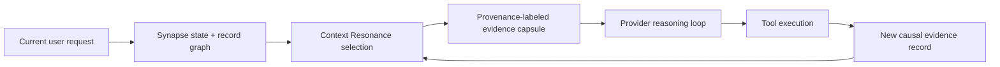

# EterX Context Resonance

Context Resonance is EterX-Synapse's closed-loop context routing layer. It is designed for a specific failure mode in autonomous agents: the useful evidence exists somewhere in memory, but a long or repetitive prompt either omits it, buries it, or keeps reinjecting stale duplicates.

The implementation does not modify model weights and is not a claim of AGI. It is an inference-time control system that decides which graph records deserve the model's limited attention after each user turn and after each new tool result.

## Core mechanism

Each eligible Synapse record receives a state-conditioned utility:

```text
U(i, s) = F(i) × [
  w_sem(s) · semantic(i) +
  w_trust(s) · confidence(i) +
  w_fresh(s) · freshness(i) +
  w_causal(s) · causal_support(i) +
  w_valid(s) · validated(i)
]

F(i) = 1 / (1 + 0.16 × prior_injections(i))
```

The weights change with the Synapse state:

- `Warmup` favors fresh evidence while the topic is being established.
- `Continuity` balances trust, freshness, and semantic fit.
- `Drift` increases semantic and causal weighting.
- `Transition` strongly favors semantic resonance over raw recency.

Selection is a deterministic, budgeted maximum-marginal-relevance pass:

```text
selection_score(i) = [U(i, s) - 0.34 × redundancy(i, selected)] / length_penalty(i)
```

This makes room for complementary evidence instead of filling the capsule with paraphrases of the same failure. Tier-1 rules remain mandatory. Superseded, rejected, and reverted records are filtered before scoring.

## Closed-loop reasoning pulses



The initial turn produces a context capsule. Every successful or failed tool call is then registered as a record linked to the current user turn. Before the next model iteration, Synapse creates a delta pulse containing newly relevant evidence. A record already injected in the current turn is suppressed, preventing prompt growth from repeated context.

This path is provider-neutral: Gemini, Anthropic, Mistral, OpenAI-compatible, and other shared provider loops use the same Synapse graph and pulse contract.

## Loss-aware compaction and evidence promotion

Tool results are distilled extractively before entering Synapse. Query-relevant statements, errors, decisions, paths, URLs, hashes, identifiers, numeric values, and verification outcomes receive priority; the distiller never invents replacement prose. The same evidence distiller is used by emergency history compression, including provider-neutral OpenAI/Mistral and Anthropic message histories, while protocol-critical tool-call IDs and tool-use blocks remain untouched.

Successful test, build, lint, compile, and verification evidence promotes the recent mutation chain to `validated` and raises its retrieval confidence. Failed verification is retained as high-authority failure evidence and lowers the confidence of recent unverified changes. This prevents a file write from becoming a durable “success” memory merely because the write call returned.

Synapse also uses bounded memory plasticity. When the record store crosses its bound, invalid versions are removed first; then old low-utility observations may be retired while system rules, validated evidence, current-topic records, and the most recent evidence remain protected. Durable tool history is still available through EterX's Lifetime Brain and conversation ledger.

## Federated memory attention

EterX has several useful memory substrates, but independently appending Agent Memory, Memory V2, Lifetime Brain, adaptive rules, and Synapse can duplicate the same fact and waste model attention. Before provider execution, the federation gate separates operational prompt kernels from memory evidence. Operational rules and skills remain byte-for-byte unchanged; memory sources are priority-ordered, extractively bounded, cross-source deduplicated, provenance-labeled, and placed inside one non-executable memory channel with a 7,000-token default budget.

Synapse evidence receives the highest memory-source priority because it has already passed version, state, confidence, causal, and resonance selection. Memory V2 and Lifetime Brain can still contribute durable information that is absent from the active graph.

## Online utility feedback

Context Resonance uses a local, non-parametric learning signal. When an injected record overlaps a later concrete tool action through its file path, entities, error terms, or exact values, Synapse records a useful injection and slightly strengthens that evidence. The useful-injection ratio feeds back into causal support on future selections. Records that are repeatedly injected without downstream use receive no reinforcement and are progressively reduced by repetition fatigue.

This is harness-level adaptation, not model-weight training. It is inspectable, reversible, scoped to the local graph, and cannot grant tools or override safety policy.

## Adaptive attention budget

The capsule does not reserve a fixed 8,000-token block. Its budget expands only when context uncertainty rises:

| State | Base tokens |
|---|---:|
| Warmup | 1,200 |
| Continuity | 1,800 |
| Drift | 3,000 |
| Transition | 4,200 |

A small logarithmic scale factor accounts for graph size, capped at 1.35×. Within-turn delta pulses are capped at 2,200 tokens.

## Safety and provenance

Recalled records are rendered inside a `NON-EXECUTABLE EVIDENCE` capsule with source, tier, selection reason, state, confidence, and token telemetry. The current request and system policy remain authoritative, and the model is explicitly told to ignore instructions embedded in recalled content. This reduces the risk of persisted prompt injection becoming executable policy.

## Reproducible internal benchmark

Run:

```powershell
npm run benchmark:context-resonance
```

The synthetic adversarial v1 suite covers duplicate flooding, repetition fatigue, topic transition, and terse causal tool evidence. On the current four designed scenarios:

| Selector | Mean precision | Mean recall |
|---|---:|---:|
| Relevance/recency baseline | 0.458 | 0.458 |
| Context Resonance | 1.000 | 1.000 |

These numbers are unit-level engineering results on a small, deliberately adversarial synthetic suite. They are not evidence of state-of-the-art performance or a statistically meaningful comparison with external systems.

## Relationship to published work

Context Resonance builds on known directions rather than pretending they do not exist:

- [Lost in the Middle](https://arxiv.org/abs/2307.03172) demonstrates that merely increasing context length does not guarantee reliable use of information throughout the prompt.
- [MemGPT](https://arxiv.org/abs/2310.08560) develops hierarchical, OS-inspired virtual context management.
- [HippoRAG](https://arxiv.org/abs/2405.14831) combines knowledge graphs and Personalized PageRank for long-term retrieval.
- [LongMemEval](https://arxiv.org/abs/2410.10813) evaluates information extraction, multi-session reasoning, temporal reasoning, knowledge updates, and abstention.
- [DF-RAG](https://aclanthology.org/2026.findings-eacl.150/) applies query-aware diversity and maximum marginal relevance to reduce redundant retrieval.

The EterX engineering hypothesis is that the useful combination for tool-using agents is: divergence-state-conditioned weights, version-aware records, live causal links from actions to evidence, repetition fatigue, adaptive token budgets, and within-turn delta reinjection. A formal novelty claim requires a broader prior-art review; a performance claim requires external benchmark results and ablations.

## Publication-grade validation plan

1. Evaluate memory retrieval and answer accuracy on LongMemEval.
2. Add lost-in-the-middle position sweeps with identical evidence at different history depths.
3. Run ablations for causal support, diversity, fatigue, adaptive budgets, and delta pulses.
4. Measure answer accuracy, evidence recall, contradiction rate, prompt tokens, latency, and tool-loop completion.
5. Compare against full-history, recency-only, cosine top-k, MMR-only, and graph-only baselines.
6. Publish the benchmark generator, seeds, raw traces, failure cases, and confidence intervals.

Fame cannot be engineered as a feature. A credible path is a clear mechanism, reproducible code, honest baselines, external evaluation, and a paper whose claims match its evidence.
