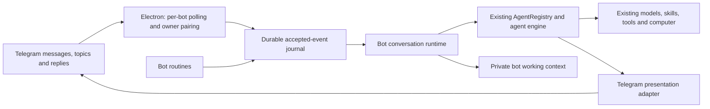

# Telegram bot teammates

Open **Channels → Connect as bot**. The page follows the Channels surface and includes a bot count, searchable roster, connection status, model/agent editor, setup instructions and a back action.

Create a Telegram identity through [BotFather](https://t.me/BotFather), paste its full token, choose a configured EterX model and agent, then open the private pairing link and press Start. Each bot has a separate, expiring pairing challenge; knowing its username does not grant access to the computer. More bots can be added using separate BotFather tokens.

Token setup accepts a clean token, BotFather's complete token message, a `bot` prefix, or an API example URL. The paste handler uses the same parser as Electron, before the password input can discard line breaks. It preserves text boundaries and never joins explanatory words onto the credential. Ambiguous tokens split across lines ask the user to copy the token itself. A visibility toggle lets the user inspect their entry locally. Setup, polling and media requests use the same Telegram client and Electron's native network stack, including the computer's system proxy. Identity verification is an uncached `getMe` GET request and retries a transient failure once. HTTP service failures take precedence over inconsistent API error bodies; HTTP and Telegram codes remain separate in diagnostics. Tokens and credential-bearing URLs are never included in those errors.

Connection failures retain the editor draft and include expandable **Connection details → Copy error details**. The details record the failing setup stage, client revision, request ID, HTTP/API codes and a network error code when available, without recording the token or raw response. The desktop log records the same safe metadata. A genuine Telegram authentication rejection still requires the current BotFather credential; HTTP 502, a proxy error or an unexpected response does not establish that the token is invalid. The development launcher watches all gateway `.cjs` helpers so changes to the token parser or transport restart Electron as well. Restart the development launcher once after updating its watcher; reloading the page alone cannot replace main-process modules.

The editor checks that its token parser and the desktop connection client have the same revision before submitting credentials. A stale main process produces a restart instruction before any verification request, so a browser-only reload cannot silently run the previous connection implementation. Editing a saved bot's role/model or pausing it does not require online token verification. New and replaced tokens are verified with `getMe`. Use **Reconnect** on an interrupted connection; a genuinely revoked token must be replaced through **Edit** with the current token from BotFather. EterX does not remove an existing webhook or take over a bot from another running process automatically.

## Architecture

This is a transport and conversation architecture around the existing agent engine. It does not introduce a reduced chatbot model or replace desktop-agent prompts. General, Coding Lite, Coding Heavy and ready custom-agent profiles retain their existing execution policies and tool settings. Each bot uses its own exact selected model.

`telegram-bot-context.ts` adds a bot-specific identity and delivery contract to the shared prompt assembly and custom-agent runner. `telegram-bot-behavior.ts` defines the teammate communication policy and a small model-boundary reminder. Custom tool execution carries the Telegram recipient and owner context, so uploads and routines use the same destination as the main agent. Existing execution policies and tools remain in force. This is runtime guidance for the selected model, not separate model training or a reduced agent.

## Behavior during work

Quick requests can finish directly. Substantial tasks receive a short contextual opening and useful updates as evidence develops: an unsuccessful search followed by a different location, a meaningful finding, a discrepancy, a usable draft, a material obstacle, a changed requirement or a real wait. An empty successful lookup is distinguished from an inaccessible folder or failed command. A search result is limited to the scope actually examined.

For example, after an actual successful search with no matching files, the bot can say: “There’s no matching workbook on your Desktop. I’m checking the redirected Documents folder next.” It continues the search in that model turn. It does not announce that no workbook exists anywhere, ask whether to continue an already authorized search, or narrate every directory read. Examples in the policy are conditional style guidance, never supplied facts.

The Gemini, Anthropic, compatible-provider and custom-agent loops refresh the communication reminder at model/tool boundaries. It considers recent public work notes and tool settlement metadata, while the actual evidence remains in the original tool transcript. Several completed actions or an extended gap can prompt a useful checkpoint; this is not a mandatory message or an extra tool/model request. Quiet preferences, meaningful changes and actual completion take precedence. The cue stays outside reusable static prompt caches. Custom Telegram notes retain their full text and a stable note ID, including fallback responses containing both text and function calls; they are no longer cut at 500 characters or classified as final text merely because streaming text was unavailable.

Corrections and asides belong to the active task. The bot should apply a changed requirement, answer a useful aside, or inspect disputed evidence, then continue remaining work. Admission is not proof that guidance was consumed: the transport sends no automatic thumbs-up or acknowledgment bubble. The existing engine applies steering at its next safe boundary.

For mobile use, the policy calls for a readable preview when appearance, a review decision or an important result requires one. It covers documents, worksheets, slide/design drafts, browser work, code/UI changes and analysis charts. Previews identify the relevant file, page, sheet or version; large results use readable pages or albums with the original file when needed. Instructions and blockers are explained in Telegram without assuming the owner can see a desktop panel. Screenshots are not taken after every click.

Visual claims require visual evidence. A capture returning a file does not prove that Excel is visible or maximized; a process list does not prove which window is on screen. When an image is disputed, the bot is instructed to inspect it, correct any false claim, and inspect a fresh capture before describing it. Background rendering remains distinct from an application screenshot, and a request not to disturb the desktop remains active. These are model operating rules, not a pixel-classification guarantee; the selected model and available inspection tools still matter.

## Interaction lifecycle

- An idle conversation starts a run using the existing AgentRegistry.
- A message during work calls `addSteeringMessage` on the active run. It does not enter the desktop follow-up queue or trigger an automatic reaction. The legacy steering-acknowledgment endpoint is a no-op for older in-flight runtimes.
- Controls, explicit question answers and active text steering bypass attachment downloads. `/stop` also prevents an earlier download or delayed admission from starting work afterward. Steering enters the existing engine at its next safe model/tool boundary; it does not interrupt an operating-system action halfway through.
- Questions use the existing `ask_user` pending-response mechanism. Small choices and confirmations use inline buttons. Longer choices and multi-select questions use non-anonymous polls when they fit Telegram's limits; multi-select polls require **Submit answers**. Text or grouped questions use replies. Full questions and descriptions are split into readable messages rather than silently cut off. Free-text replies remain possible; multiple selections also accept comma-separated option numbers. Answered, interrupted and expired questions have their controls retired. `/steer <guidance>` interrupts a waiting question without granting approval. Reply-to and callback IDs retain the originating conversation after a switch. Confirmation requires an explicit answer; expiration never grants permission.
- Work notes are relayed as ordinary Telegram messages. Cumulative revisions edit the same message or message parts; distinct notes remain separate. A brief settling delay avoids uploading half-written artifact links. If a running task has no note after 12 seconds, or its last note is more than 45 seconds old, one silent editable activity message supplies a conservative status from actual tool lifecycle events. It includes **Latest update** and **Stop** buttons and is removed when useful notes, a question or the result arrive. Stop callbacks carry the run identity, so an old control cannot cancel newer work. Private reasoning, raw tool arguments/results and fabricated completion percentages are never used as progress.
- `/quiet` suppresses optional notes and activity messages for that conversation; `/updates` restores them. Results, files and necessary questions remain available. The preference persists and is included in subsequent runs' bot context.
- Images can be photo previews, MP4 playable video, MP3/M4A audio, and other outputs documents. `gateway_bridge.files_send` inherits the paired recipient. `file_paths` sends 2–10 related files as an album (up to 100 MB total); document and audio albums must contain that type only. A single file uses `file_path`. Keep captions below 1,000 characters; an overlong caption is shortened and reported as `caption_truncated` to the tool. Original documents and visual previews should be sent separately when both are useful.
- Explicit local deliverable links in settled work notes and final responses also upload files, including for coding profiles without gateway tools. The resolver accepts absolute paths, `file://` URLs and the desktop `#eterx-local-file:` encoding. Code examples are excluded. Successfully delivered file versions are recorded by normalized path, size and modification time, preventing duplicate uploads between explicit file tools, notes and the final response while allowing revised files. Failed attachments are reported in the result. Arbitrary observed files and tool arguments never trigger automatic uploads.
- Users can send photos, documents, audio and video. Incoming Telegram albums are assembled during a short 1.2-second quiet window (bounded at 4 seconds), so captions and files reach one task together. Assembly is persisted before advancing update offsets and resumes after restart; controls and text steering do not wait for it. Authorized downloads become local attachments in the existing agent/provider pipeline, including steering and question replies. Quoted reply passages are preserved. Send an image as a document to preserve its original bytes. Attachment errors report the actual failure; the selected provider and tools determine which formats can be understood.
- User-requested routines use the existing `scheduled_tasks` tool with bot-scoped persistence and Telegram delivery. They use the bot’s current model/profile. If the conversation is busy, the occurrence is skipped rather than queued or injected as user steering. Missed repeating intervals coalesce to one occurrence when the device returns.

## Conversations and storage

`/new`, `/chats`, and `/switch <number>` provide independent working contexts within a private Telegram chat. With Telegram Topics enabled in BotFather, `/new` creates a native private topic. Incoming topic IDs are part of conversation identity. Bot IDs, paired users, topics and conversation IDs never share an execution key.

Replying to a bot update or delivered file addresses its original conversation even after `/switch`. A bounded durable reply map retains the latest 5,000 message routes; each agent session is scoped to its bot and conversation. Bot prose has no automatic conversation-number headers, including when several virtual conversations exist. Native Telegram reply references identify the originating request, and topics supply their own boundary. Deleted source messages do not block delivery. Conversation numbers remain available in the explicit navigation commands.

Successfully delivered work notes and questions are retained as model conversation entries. Revisions update the same note entry rather than appending copies. Final history uses the prepared attachment-aware response. This lets follow-up requests refer to a finding or choice that appeared mid-task. Existing receipts from older builds provide a bounded reference to their delivered notes until newer history takes over. Recent delivered files are supplied as scoped reference data, and replies to a delivered file carry that specific file's receipt (path, size and modification time). The agent is instructed to inspect it and disclose if the local source has changed instead of pretending it is the exact image the owner saw. No extra desktop chat is created.

`telegram-presentation.cjs` is shared by text delivery, editable notes, questions and media captions. It converts a conservative Markdown subset into native Telegram entities, splits text at Unicode-safe boundaries with UTF-16 entity offsets, preserves public source links, and keeps desktop-only file URLs out of visible messages. Bold, emphasis, strikethrough, headings and code are supported; simple tables become compact preformatted text. This is not a desktop HTML/Markdown renderer: complex layouts belong in an attached document or image.

Telegram holds the visible message history. The Bot API is an update transport, not a complete historical transcript database, so EterX retains private working context, delivery receipts, bot settings, attachments and routines in its platform-specific application data directory. Bot conversations do not create entries in the desktop chat list. Deleting Telegram messages does not erase this local working context. Disconnecting removes the active credential configuration and pairing, but deliberately preserves conversation data.

Tokens use the existing encrypted gateway credential store and are removed from renderer-facing configuration. Bot context is separate from the ordinary desktop chat store. Files are downloaded only after owner authorization. This first implementation accepts paired private chats and private topics; it does not grant group members access to the host computer.

## Device and recovery behavior

Polling runs in Electron’s main process and needs no public webhook, inbound port forwarding or cloud computer. The existing hidden desktop renderer relays accepted IDs to the server and reconciles pending bot events. Agent execution continues in the existing server runtime when the main window is hidden. Keep EterX running, the computer awake and internet access available. Sign-in startup is controlled by the existing Gateway setting on Windows, macOS and Linux.

Background bot reconciliation starts only when the gateway has an enabled, paired bot, and only one reconciliation request is in flight at a time. The schedule tick uses a lightweight scheduler and gateway client; it does not import AgentRegistry or model SDKs. Due routines enter the durable event journal and then follow the usual dispatch path, which skips busy conversations. Merely opening EterX or Channels does not compile the bot execution runtime through a periodic timer.

Channels and Connect as bot load independently. Their screen loader catches failed chunk downloads, retries a transient failure once, and offers Try again / Reload app while the rest of the interface remains usable. Reload uses the existing desktop startup and durable-state flush flow. Development output and remote image attachments are excluded from source watching.

Telegram update offsets, event IDs, conversation state and outbound delivery records persist across restarts. Run admission uses a stable event-derived ID. A reconnect reattaches to an existing execution. After a process restart, interrupted work asks the owner to continue instead of automatically replaying possibly completed side effects. Text delivery retries freeze the formatted chunks and retain the successful chunk count. Progress edits retain message IDs by run and note, including partial multi-message delivery. A connection loss after Telegram accepts a send but before its response reaches EterX can still duplicate a message or attachment; Telegram does not provide client idempotency for these sends.

Bot-only configuration changes restart only the affected pollers. A temporary gateway restart or network interruption does not revoke ownership or stop active agent work. An explicit pause, disconnect or revoked pairing does stop it. Disabled bots are excluded from pending-input reconciliation so they cannot block active bots' messages.

`/status` reports the selected model and execution state; `/peek` includes the current activity or waiting question plus the latest note, and shows the latest result when idle. `/stop` cancels that conversation's active task. A screenshot is an actual point-in-time capture; a background-rendered document preview is labeled as such. Neither is a continuous desktop video stream.

## Telegram constraints and references

The implementation uses official [Telegram bot features](https://core.telegram.org/bots/features) and the [Bot API](https://core.telegram.org/bots/api): long polling, account deep links, private topics, polls, callback buttons, typing activity, native reply references, message edits and media uploads. Standard Bot API downloads are limited to 20 MB, document uploads to 50 MB, and photos to 10 MB. Pending Telegram updates are retained for at most 24 hours. Provider capabilities and device permissions still determine which work an agent can perform.

The role-oriented, conversational behavior is informed by the supplied references and [Grok Bot’s overview](https://docs.x.ai/grok-bot/overview); EterX performs the work on the user’s connected computer.

No build, lint, type check, test suite, or live Telegram connection was run for this change, as requested.
