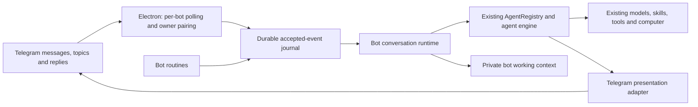

# Telegram bot teammates

Open **Channels → Connect as bot**. The page follows the Channels surface and includes a bot count, searchable roster, connection status, model/agent editor, setup instructions and a back action.

Create a Telegram identity through [BotFather](https://t.me/BotFather), paste its full token, choose a configured EterX model and agent, then open the private pairing link and press Start. Each bot has a separate, expiring pairing challenge; knowing its username does not grant access to the computer. More bots can be added using separate BotFather tokens.

Token setup accepts a clean token, BotFather's complete token message, a `bot` prefix, or an API example URL. The paste handler uses the same parser as Electron, before the password input can discard line breaks. It preserves text boundaries and never joins explanatory words onto the credential. Ambiguous tokens split across lines ask the user to copy the token itself. A visibility toggle lets the user inspect their entry locally. Setup, polling and media requests use the same Telegram client and Electron's native network stack, including the computer's system proxy. Identity verification is an uncached `getMe` GET request and retries a transient failure once. HTTP service failures take precedence over inconsistent API error bodies; HTTP and Telegram codes remain separate in diagnostics. Tokens and credential-bearing URLs are never included in those errors.

Connection failures retain the editor draft and include expandable **Connection details → Copy error details**. The details record the failing setup stage, client revision, request ID, HTTP/API codes and a network error code when available, without recording the token or raw response. The desktop log records the same safe metadata. A genuine Telegram authentication rejection still requires the current BotFather credential; HTTP 502, a proxy error or an unexpected response does not establish that the token is invalid. The development launcher watches all gateway `.cjs` helpers so changes to the token parser or transport restart Electron as well. Restart the development launcher once after updating its watcher; reloading the page alone cannot replace main-process modules.

The editor checks that its token parser and the desktop connection client have the same revision before submitting credentials. A stale main process produces a restart instruction before any verification request, so a browser-only reload cannot silently run the previous connection implementation. Editing a saved bot's role/model or pausing it does not require online token verification. New and replaced tokens are verified with `getMe`. Use **Reconnect** on an interrupted connection; a genuinely revoked token must be replaced through **Edit** with the current token from BotFather. EterX does not remove an existing webhook or take over a bot from another running process automatically.

## Architecture

This is a transport and conversation architecture around the existing agent engine. It does not introduce a reduced chatbot model or replace desktop-agent prompts. General, Coding Lite, Coding Heavy and ready custom-agent profiles retain their existing execution policies and tool settings. Each bot uses its own exact selected model.

`telegram-bot-context.ts` adds a bot-specific identity and communication contract to the shared prompt assembly for each provider. The contract specializes desktop presentation: short colleague-like messages, contextual asides, useful findings, actual previews, focused questions and concise deliverables. The bot can communicate throughout a task. A completed execution turn does not erase the bot or its conversation context.

## Interaction lifecycle

- An idle conversation starts a run using the existing AgentRegistry.
- A message during work calls `addSteeringMessage` on the active run. It does not enter the desktop follow-up queue. Telegram acknowledges accepted steering with a reaction when supported.
- Controls, explicit question answers and active text steering bypass attachment downloads. `/stop` also prevents an earlier download or delayed admission from starting work afterward. Steering enters the existing engine at its next safe model/tool boundary; it does not interrupt an operating-system action halfway through.
- Questions use the existing `ask_user` pending-response mechanism. Choices render as non-anonymous Telegram polls, multi-select polls require **Submit answers**, confirmations use inline buttons, and text or grouped questions use replies. Option descriptions remain visible. Answered polls close and their buttons are retired. `/steer <guidance>` interrupts a waiting question without granting approval. Reply-to and callback IDs retain the originating conversation even after the user switches conversations. Confirmation requires an explicit answer; expiration never grants permission.
- Work notes are relayed as ordinary Telegram messages. Cumulative revisions of one note edit its bubble; distinct notes remain separate messages. Private reasoning and raw tool traces are not sent as progress.
- Images can be sent as photo previews, MP4 as playable video, MP3/M4A as audio, and other outputs as documents. `gateway_bridge.files_send` inherits the paired recipient from the runtime. Absolute file links in final responses are also delivered, including for focused coding modes.
- Users can send photos, documents, audio and video from Telegram. Authorized downloads become original local media attachments in the existing agent/provider pipeline, including live steering and replies to a pending question. Send an image as a Telegram file/document to preserve its original bytes. Attachment errors report the actual failure instead of blaming every failed download on its size.
- User-requested routines use the existing `scheduled_tasks` tool with bot-scoped persistence and Telegram delivery. They use the bot’s current model/profile. If the conversation is busy, the occurrence is skipped rather than queued or injected as user steering. Missed repeating intervals coalesce to one occurrence when the device returns.

## Conversations and storage

`/new`, `/chats`, and `/switch <number>` provide independent working contexts within a private Telegram chat. With Telegram Topics enabled in BotFather, `/new` creates a native private topic. Incoming topic IDs are part of conversation identity. Bot IDs, paired users, topics and conversation IDs never share an execution key.

Replying to a bot update or delivered file addresses its original conversation even after `/switch`. A bounded durable reply map retains the latest 5,000 message routes; each agent session is scoped to its bot and conversation. Native topics omit the extra conversation label because Telegram already supplies the thread boundary.

Telegram holds the visible message history. The Bot API is an update transport, not a complete historical transcript database, so EterX retains private working context, delivery receipts, bot settings, attachments and routines in its platform-specific application data directory. Bot conversations do not create entries in the desktop chat list. Deleting Telegram messages does not erase this local working context. Disconnecting removes the active credential configuration and pairing, but deliberately preserves conversation data.

Tokens use the existing encrypted gateway credential store and are removed from renderer-facing configuration. Bot context is separate from the ordinary desktop chat store. Files are downloaded only after owner authorization. This first implementation accepts paired private chats and private topics; it does not grant group members access to the host computer.

## Device and recovery behavior

Polling runs in Electron’s main process and needs no public webhook, inbound port forwarding or cloud computer. The existing hidden desktop renderer relays accepted IDs to the server and reconciles pending bot events. Agent execution continues in the existing server runtime when the main window is hidden. Keep EterX running, the computer awake and internet access available. Sign-in startup is controlled by the existing Gateway setting on Windows, macOS and Linux.

Background bot reconciliation starts only when the gateway has an enabled, paired bot, and only one reconciliation request is in flight at a time. The schedule tick uses a lightweight scheduler and gateway client; it does not import AgentRegistry or model SDKs. Due routines enter the durable event journal and then follow the usual dispatch path, which skips busy conversations. Merely opening EterX or Channels does not compile the bot execution runtime through a periodic timer.

Channels and Connect as bot load independently. Their screen loader catches failed chunk downloads, retries a transient failure once, and offers Try again / Reload app while the rest of the interface remains usable. Reload uses the existing desktop startup and durable-state flush flow. Development output and remote image attachments are excluded from source watching.

Telegram update offsets, event IDs, conversation state and outbound delivery records persist across restarts. Run admission uses a stable event-derived ID. A reconnect reattaches to an existing execution. After a process restart, interrupted work asks the owner to continue instead of automatically replaying possibly completed side effects. Text delivery retries use an idempotency key and retain the count of successfully sent chunks. As with any external messaging API without client idempotency, a connection loss after Telegram accepts a send but before its response reaches EterX can still duplicate a message or attachment.

Bot-only configuration changes restart only the affected pollers. A temporary gateway restart or network interruption does not revoke ownership or stop active agent work. An explicit pause, disconnect or revoked pairing does stop it. Disabled bots are excluded from pending-input reconciliation so they cannot block active bots' messages.

`/status` reports the selected model and current execution state; `/peek` reports the latest visible work update; `/stop` cancels that conversation’s active task. Screenshots are actual point-in-time artifacts produced with enabled tools, not a continuous remote-desktop video stream.

## Telegram constraints and references

The implementation uses official [Telegram bot features](https://core.telegram.org/bots/features) and the [Bot API](https://core.telegram.org/bots/api): long polling, account deep links, private topics, polls, callback buttons, typing activity, reactions, message edits and media uploads. Standard Bot API downloads are limited to 20 MB, document uploads to 50 MB, and photos to 10 MB. Pending Telegram updates are retained for at most 24 hours. Provider capabilities and device permissions still determine which work an agent can perform.

The role-oriented, conversational behavior is informed by the supplied references and [Grok Bot’s overview](https://docs.x.ai/grok-bot/overview); EterX performs the work on the user’s connected computer.

No build, lint, type check, test suite, or live Telegram connection was run for this change, as requested.
