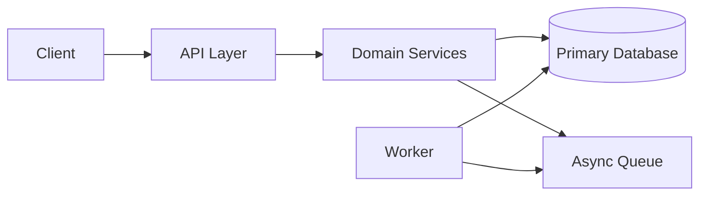

# Senior Architect

Use this skill to turn ambiguous architecture work into concrete decisions, diagrams, tradeoffs, and migration steps.

## Operating Mode

1. Start from the existing system: read manifests, folders, entry points, APIs, deployment files, data stores, queues, and runtime configuration.
2. State constraints: team size, traffic, latency, budget, compliance, deployment model, operational maturity, and migration tolerance.
3. Prefer boring, observable designs over clever distributed systems. Add services, queues, caches, or eventing only when they solve a named pressure.
4. Separate facts from assumptions. Mark unknowns and give the smallest investigation needed to close them.
5. Produce an ADR-style recommendation with consequences, risks, rollback, and phased adoption.

## Local Discovery

Use commands that fit the repository:

```bash
rg --files
rg -n "createServer|listen\\(|router|Controller|app\\.use|PrismaClient|mongoose|sequelize|typeorm|redis|kafka|rabbit|sqs|pubsub"
npm ls --depth=0
pnpm why <package>
go list ./...
cargo tree
dotnet list package
```

Read infrastructure files when present: `Dockerfile`, `docker-compose.yml`, Kubernetes manifests, Terraform, CI files, deployment scripts, OpenAPI specs, database migrations, and runbooks.

## Architecture Review Checklist

- Boundaries: modules own clear data and behavior; no circular domain dependencies.
- Data: source of truth is explicit; consistency model is named; migrations and backups are covered.
- APIs: contracts are versioned, validated, documented, and backward-compatible.
- Reliability: timeouts, retries, idempotency, queue semantics, and graceful degradation are designed.
- Observability: logs, metrics, traces, correlation IDs, alerts, and dashboards cover critical paths.
- Security: authn/authz, tenant isolation, secret handling, audit trails, and least privilege are explicit.
- Operations: deploy, rollback, scaling, incident response, and cost controls are practical for the team.

## Diagram Guidance

Use Mermaid by default unless the repo already has another standard.



Keep diagrams honest: show only components that exist or are part of the proposed change, label external systems, and mark async boundaries.

## Decision Output

For architecture decisions, return:

- Recommendation: the chosen option in one paragraph.
- Context: facts and constraints that matter.
- Options considered: 2-4 alternatives with tradeoffs.
- Design: components, data flow, failure behavior, and security boundaries.
- Migration plan: phases, compatibility strategy, rollback.
- Verification: tests, load checks, observability, and acceptance criteria.
- Risks: unresolved unknowns and owner/date for follow-up.

## Red Flags

- Introducing microservices to avoid modularizing a monolith.
- Adding caches without invalidation and consistency rules.
- Adding queues without idempotent consumers and retry/dead-letter behavior.
- Choosing databases by familiarity alone while ignoring access patterns.
- Shipping architecture diagrams that do not match the code or deployment reality.
